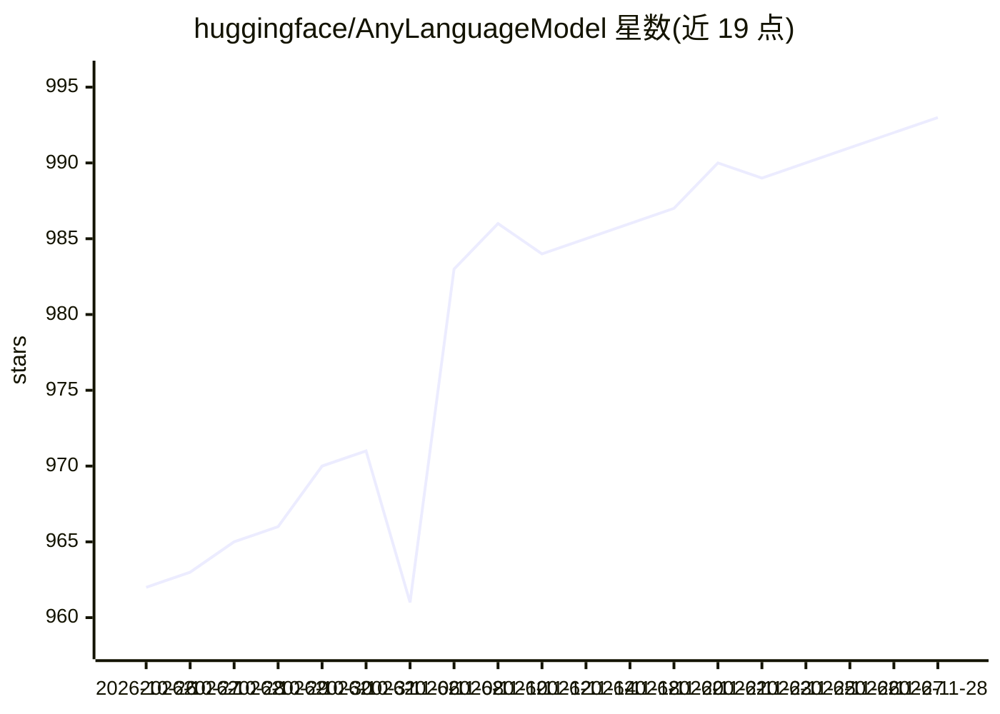

# huggingface/AnyLanguageModel

⭐ 993 · Swift · Apache-2.0 · 推送 2026-11-25 · [GitHub](https://github.com/huggingface/AnyLanguageModel) · 组织维护

**Swift 开发者接入多语言模型后端的 API 兼容层**

Swift 包，替换 Apple Foundation Models 框架的 import 即可接入自定义语言模型提供方。支持 Apple 端上模型、Core ML、MLX、llama.cpp、Ollama 及 Anthropic/Gemini/OpenAI 等云端 API，通过 Swift traits 按需启用后端以减小二进制体积。保留 Tool 调用、@Generable 引导生成等框架 API 形态，并扩展图像输入等能力。面向 Swift/iOS 等平台开发者，需 Swift 6.3+ 与 Xcode 26.4+。

## 筛选速览

| 维度 | 判定 | 备注 |
|---|---|---|
| AI 角色 | `ai-ecosystem` | LLM/agent 周边工具 |
| 许可风险 | `permissive` | Apache-2.0 |
| 部署形态 | `None` |  |
| 模型依赖 | local-ok | 支持本地模型 |
| 硬件要求 | — | 无带数字的原话,不猜 |
| 安装摩擦 | `medium` | 含编译或系统依赖之一 |
| 成熟度 | — | 结构信号不足 |

## 能力要点

- 改一行 import 即替换 Foundation Models 的 API 兼容层
- 支持 10 类模型提供方：Apple、Core ML、MLX、llama.cpp、Ollama 及主要云端 API
- Swift traits 按需启用后端，默认无额外依赖
- 支持 @Generable 引导生成与图像输入（扩展能力）

## 适用场景

- 为 iOS/macOS 应用切换或自定义语言模型后端
- 在 Apple 平台上用本地 GGUF/MLX 模型替代云端调用
- 以统一 API 同时对接多家云端模型服务

## 场景标签

`模型网关` · 领域:Agent 开发

## 证据(README 行号)

> L3: A Swift package that provides a drop-in replacement for
> L5: with support for custom language model providers.
> L36: ### Supported Providers

## 星数曲线

2026-10-26 962 → 2026-11-28 993（+31）

---
*卡片 v1 · prompt 1.4 · 生成 2026-11-24 · 置信度 high · 依据 README sha `68a8008a01c2` · [字段定义](../../DATASET.md)*
