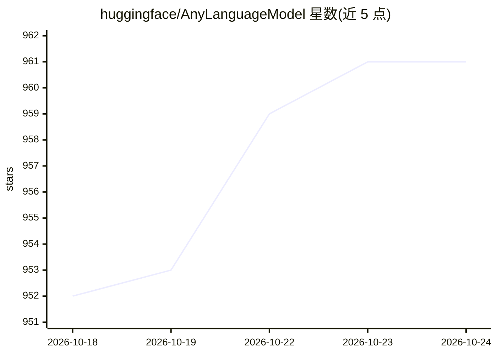

# huggingface/AnyLanguageModel

⭐ 961 · Swift · Apache-2.0 · 推送 2026-10-22 · [GitHub](https://github.com/huggingface/AnyLanguageModel) · 组织维护

**Apple Foundation Models 的 Swift API 兼容替代库，可接入自选模型后端**

Swift 包形式的框架层封装：保持 Apple Foundation Models API 兼容，开发者仅改 import 即可切换到其他语言模型后端，包括 Apple Private Cloud Compute、Core ML、MLX、llama.cpp（GGUF）、Ollama、Anthropic、Gemini、OpenAI 等。支持引导生成（@Generable 强类型输出）、图像输入（按 provider 而异）、工具调用与动态指令；通过 Swift Package traits 按需启用重型依赖以缩小产物体积。要求 Swift 6.3+，运行于 iOS 17+/macOS 14+/visionOS/Linux，Xcode 项目需经 shim 包启用 traits。

## 筛选速览

| 维度 | 判定 | 备注 |
|---|---|---|
| AI 角色 | `ai-ecosystem` | LLM/agent 周边工具 |
| 许可风险 | `permissive` | Apache-2.0 |
| 部署形态 | `None` |  |
| 模型依赖 | local-ok | 支持本地模型 |
| 硬件要求 | — | 无带数字的原话,不猜 |
| 安装摩擦 | `medium` | 含编译或系统依赖之一 |
| 成熟度 | — | 结构信号不足 |

## 能力要点

- 与 Apple Foundation Models API 兼容，改 import 即可替换后端
- 支持 11 种 provider（端侧 Core ML/MLX/llama.cpp 与 OpenAI/Anthropic/Gemini 云端 API）
- 引导生成、图像输入、工具调用、动态指令等能力
- Package traits 按需启用后端依赖，减小二进制体积

## 适用场景

- 在现有 Foundation Models 代码中切换为自定义或云端模型 provider
- iOS/macOS 应用接入本地 MLX 或 llama.cpp 模型
- 同一套 API 同时面向端侧与云端多 provider 部署

## 场景标签

`模型网关` · 领域:Agent 开发

## 证据(README 行号)

> L3: A Swift package that provides a drop-in replacement for
> L5: with support for custom language model providers.
> L36: ### Supported Providers

## 星数曲线

2026-10-18 952 → 2026-10-24 961（+9）

---
*卡片 v1 · prompt 1.4 · 生成 2026-10-21 · 置信度 high · 依据 README sha `15d85c7ddaa5` · [字段定义](../../DATASET.md)*
