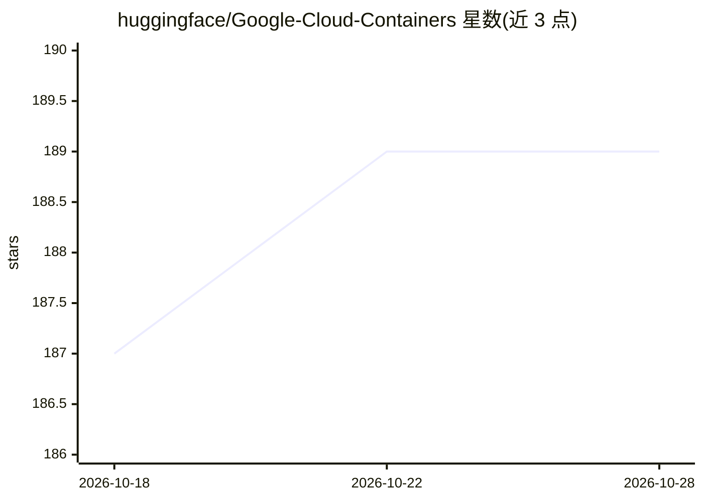

# huggingface/Google-Cloud-Containers

⭐ 189 · Dockerfile · Apache-2.0 · 推送 2026-10-06 · [GitHub](https://github.com/huggingface/Google-Cloud-Containers) · [官网](https://hf.co/docs/google-cloud) · 组织维护

**面向 Google Cloud 的 Hugging Face 深度学习容器（训练/推理 Docker 镜像）**

由 Hugging Face 与 Google Cloud 联合维护的 Docker 镜像仓库：提供预构建的深度学习容器，用于在 Vertex AI、GKE 和 Cloud Run 上训练与部署 Transformers、Sentence Transformers 和 Diffusers 模型。容器分训练（PyTorch GPU）与推理（PyTorch CPU/GPU、TGI GPU、TEI CPU/GPU）两类，镜像发布在 Google Cloud Artifact Registry，供所有 Google Cloud 客户使用。仓库同时包含各场景的微调与部署示例 notebook。TPU 版容器标注为即将发布。

## 筛选速览

| 维度 | 判定 | 备注 |
|---|---|---|
| AI 角色 | `ai-ecosystem` | LLM/agent 周边工具 |
| 许可风险 | `permissive` | Apache-2.0 |
| 部署形态 | `desktop` | 安装包/桌面程序 |
| 模型依赖 | — | README 未给出锁定关系 |
| 硬件要求 | — | 无带数字的原话,不猜 |
| 安装摩擦 | `medium` | 含编译或系统依赖之一 |
| 成熟度 | — | 结构信号不足 |

## 能力要点

- 训练与推理两类容器：PyTorch Training、PyTorch Inference、TGI、TEI
- 镜像由 Hugging Face 与 Google Cloud 联合定期更新，发布于 Artifact Registry
- 覆盖 Vertex AI / GKE / Cloud Run 三种部署服务的示例工程
- 示例包含 SFT、LoRA 微调及 Llama 3.1 405B 等模型部署

## 适用场景

- 在 Vertex AI 或 GKE 上微调 Transformers 模型
- 用 TGI/TEI 容器在 Google Cloud 部署文本生成与嵌入模型
- 在 Cloud Run 上以容器方式运行开源 LLM 推理

## 场景标签

`微调` `推理引擎` · 领域:训练与推理

## 证据(README 行号)

> L5: Hugging Face Deep Learning Containers (DLCs) for Google Cloud are a set of Docker images for training and deploying 
> L7: The Google-Cloud-Containers repository contains the container files for building Hugging Face-specific Deep Learning

## 星数曲线

2026-10-18 187 → 2026-10-28 189（+2）

---
*卡片 v1 · prompt 1.4 · 生成 2026-10-22 · 置信度 high · 依据 README sha `0571163b2f2f` · [字段定义](../../DATASET.md)*
