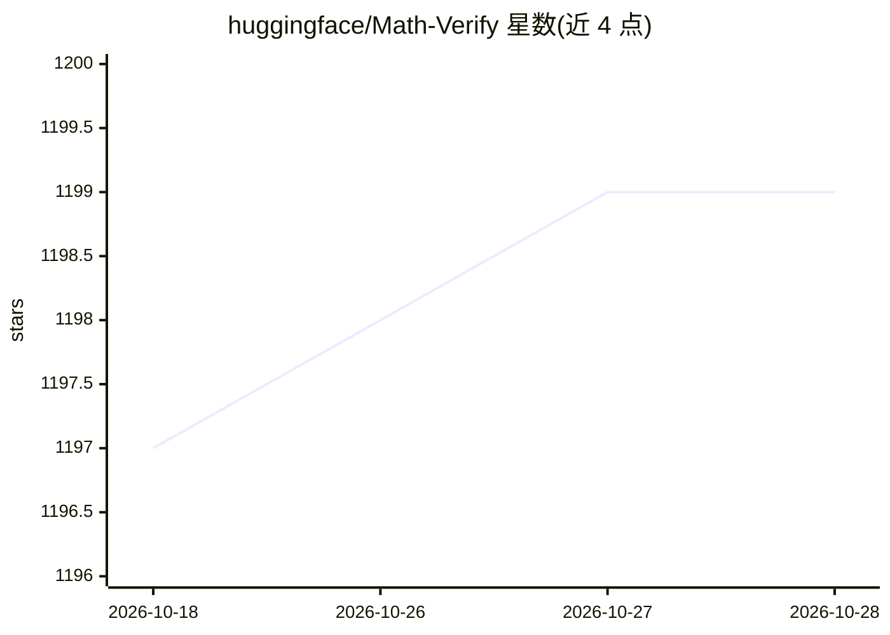

# huggingface/Math-Verify

⭐ 1,199 · Python · Apache-2.0 · 推送 2026-01-10 · [GitHub](https://github.com/huggingface/Math-Verify) · 组织维护

**面向 LLM 数学任务的答案评测校验库，判定输出与标准答案等价**

HuggingFace 维护的数学表达式评测系统，用于评估大模型在数学任务上的输出：从模型回答中以格式无关方式抽取答案（LaTeX/纯表达式/字符串三种抽取配置），经 ANTLR4 文法解析为 SymPy 表示，再与 gold 答案做字符串、数值与符号等多层比较；支持集合、区间、矩阵、复数、不等式翻转等场景。提供 CLI 脚本对 CSV 输出打分，并带端到端评测脚本（MATH-500、GSM8K、AIME24 等）。verify 函数存在有意的不对称设计以防 reward hacking。

## 筛选速览

| 维度 | 判定 | 备注 |
|---|---|---|
| AI 角色 | `ai-ecosystem` | LLM/agent 周边工具 |
| 许可风险 | `permissive` | Apache-2.0 |
| 部署形态 | `library` | 以包/库形式分发 |
| 模型依赖 | — | README 未给出锁定关系 |
| 硬件要求 | — | 无带数字的原话,不猜 |
| 安装摩擦 | `low` | 无编译、无系统依赖或容器化 |
| 成熟度 | — | 结构信号不足 |

## 能力要点

- 三步流程：答案抽取 → SymPy 公共表示 → gold 比较
- LaTeX / 纯表达式 / 字符串三种抽取配置
- 支持集合、区间、矩阵、复数与不等式翻转比较，带超时保护
- 提供 evaluate_model.py 端到端评测脚本，覆盖 MATH-500/GSM8K/AIME24 等数据集

## 适用场景

- 给 LLM 数学评测基准（如 AIME、GSM8K）做答案校验
- RL 训练中作为数学任务的 reward 校验器
- 批量对 CSV 中的模型输出打分

## 场景标签

`模型评测` · 领域:评测与运维

## 证据(README 行号)

> L2: A robust mathematical expression evaluation system designed for assessing Large Language Model outputs in mathematic
> L77: If you want to evaluate a model from ground up, we have provided a script for end to end evaluation with support fo
> L91: python evaluate_model.py --model <model_name> (HuggingFaceTB/SmolLM2-135M) --use_chat_template (True) --task <task_

## 星数曲线

2026-10-18 1,197 → 2026-10-28 1,199（+2）

---
*卡片 v1 · prompt 1.4 · 生成 2026-10-21 · 置信度 high · 依据 README sha `ce8daa2ee528` · [字段定义](../../DATASET.md)*
