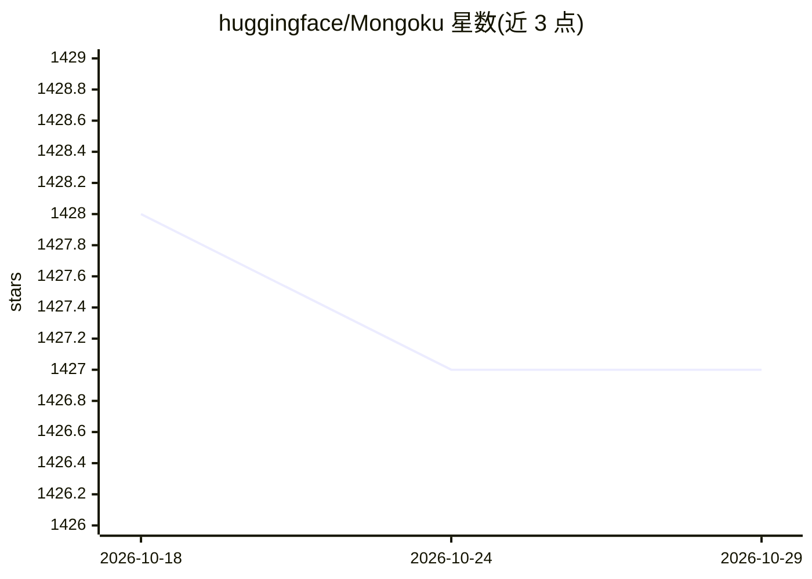

# huggingface/Mongoku

⭐ 1,427 · Svelte · MIT · 推送 2026-10-26 · [GitHub](https://github.com/huggingface/Mongoku) · 组织维护

**基于浏览器的 MongoDB Web 管理客户端**

Mongoku 是一个用 TypeScript/Node.js/SvelteKit 构建的 MongoDB Web 客户端，支持在浏览器中直接查询数据，可本地或远程部署给个人或团队使用。据 README，Hugging Face 在 1TB+ 集群上使用它，支持 sort/skip/limit 操作，并提供文档间映射以方便导航数据库。提供 npm 全局安装与 Docker 镜像两种方式，针对 MongoDB < 4.2 与 AWS DocumentDB < 5.0 提供 compat 兼容版本。

## 筛选速览

| 维度 | 判定 | 备注 |
|---|---|---|
| AI 角色 | `ai-ecosystem` | LLM/agent 周边工具 |
| 许可风险 | `permissive` | MIT |
| 部署形态 | `self-host` | docker 或自建部署 |
| 模型依赖 | — | README 未给出锁定关系 |
| 硬件要求 | — | 无带数字的原话,不猜 |
| 安装摩擦 | `low` | 无编译、无系统依赖或容器化 |
| 成熟度 | — | 结构信号不足 |

## 能力要点

- 浏览器端直接查询 MongoDB 数据
- 支持 sort/skip/limit 等操作与文档间映射导航
- npm 全局安装与 Docker 镜像两种部署方式
- compat 版本兼容旧版 MongoDB（<4.2）与 AWS DocumentDB（<5.0）

## 适用场景

- 在浏览器中查看与查询 MongoDB 数据库
- 为团队部署一个共享的数据库管理界面
- 管理旧版 MongoDB 或 AWS DocumentDB 实例

## 场景标签

 · 领域:数据库管理工具

## 证据(README 行号)

> L5: MongoDB client for the web. Query your data directly from your browser. You can host it locally,
> L9: operations, including sort/skip/limit. Built on TypeScript/Node.js/SvelteKit.

## 星数曲线

2026-10-18 1,428 → 2026-10-29 1,427（-1）

---
*卡片 v1 · prompt 1.4 · 生成 2026-10-21 · 置信度 high · 依据 README sha `0f5e924ed21d` · [字段定义](../../DATASET.md)*
