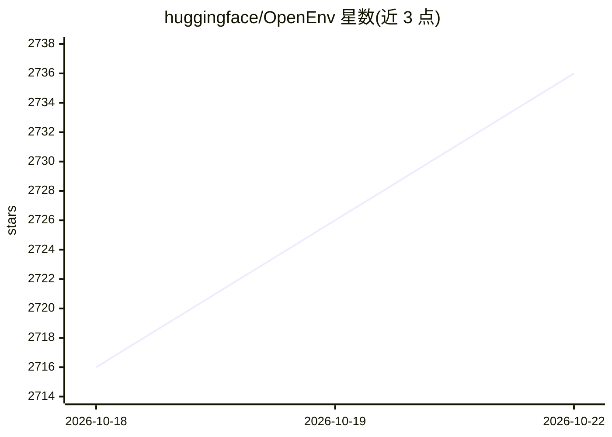

# huggingface/OpenEnv

⭐ 2,736 · Python · BSD-3-Clause · 推送 2026-10-21 · [GitHub](https://github.com/huggingface/OpenEnv) · [官网](https://huggingface.co/docs/openenv/index) · 组织维护

**面向 agentic RL 的隔离执行环境框架：创建、部署与统一调用**

端到端框架，用于创建、部署和使用供 agentic 强化学习训练的隔离执行环境：每个环境为一个 Docker 镜像，可本地、云沙箱或 Hugging Face Spaces 运行，通过 reset()/step()/state() 的 Gymnasium 风格 API（同步/异步，基于 WebSocket）访问。内置 40+ 环境（游戏、代码沙箱、浏览器、金融、模拟器），支持 TRL、Unsloth、SkyRL 等 9 个训练框架集成，Harbor 集成可运行 Claude Code、Codex 等真实 agent harness 并捕获 token 用于 RL，另支持 MCP 工具服务与 rubric 奖励、Inspect AI 评测。项目声明处于早期开发阶段，API 可能变动。

## 筛选速览

| 维度 | 判定 | 备注 |
|---|---|---|
| AI 角色 | `ai-ecosystem` | LLM/agent 周边工具 |
| 许可风险 | `permissive` | BSD-3-Clause |
| 部署形态 | `library` | 以包/库形式分发 |
| 模型依赖 | — | README 未给出锁定关系 |
| 硬件要求 | — | 无带数字的原话,不猜 |
| 安装摩擦 | `low` | 无编译、无系统依赖或容器化 |
| 成熟度 | `idea` | |

## 能力要点

- 单一 API（reset/step/state，同步或异步，WebSocket）访问所有环境
- 每个环境为 Docker 镜像，可部署到本地、云沙箱或 Hugging Face Spaces
- 与 TRL、Unsloth、SkyRL、ART 等 9 个 RL 训练框架集成
- Harbor 集成运行 Claude Code/Codex 等真实 harness 并捕获训练 token

## 适用场景

- 为 agentic RL 训练提供隔离、可部署的环境后端
- 在 TRL/SkyRL 等框架中训练多轮工具调用 agent
- 用 openenv CLI 脚手架构建并发布自定义环境到 Hugging Face Spaces

## 场景标签

`强化学习` · 领域:训练与推理

## 证据(README 行号)

> L3: An end-to-end framework for creating, deploying and using isolated execution environments for agentic RL, with a sim
> L17: - **Train with your framework.** TRL, Unsloth, SkyRL, ART, Oumi, torchforge, Miles and more (see Integrations).
> L60: - **Environments as tools (white-box).** The trainer runs the multi-turn tool loop and the environment supplies the

## 星数曲线

2026-10-18 2,716 → 2026-10-22 2,736（+20）

---
*卡片 v1 · prompt 1.4 · 生成 2026-10-21 · 置信度 high · 依据 README sha `c4794da87361` · [字段定义](../../DATASET.md)*
