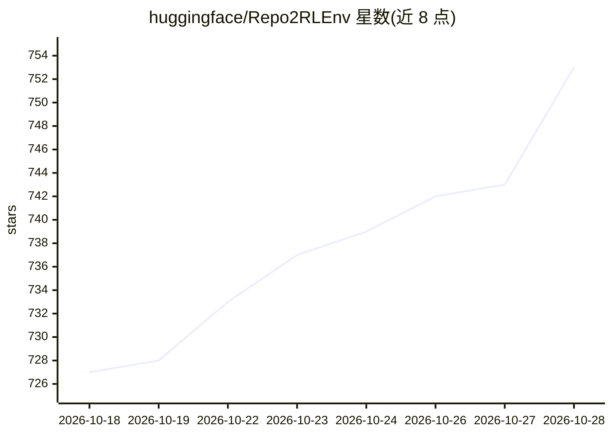

# huggingface/Repo2RLEnv

⭐ 753 · Python · Apache-2.0 · 推送 2026-10-26 · [GitHub](https://github.com/huggingface/Repo2RLEnv) · [官网](https://huggingface.github.io/Repo2RLEnv/) · 组织维护

**把任意代码仓库转成可验证 RL 环境的生成工具**

由 Hugging Face 维护的 CLI 工具：从已合并 PR、提交历史、安全公告、终端录制等既有材料生成 Harbor 格式的可验证强化学习任务，供编码 agent 训练、评测与在 Hub 上分享。提供 23 种生成器、21 个已发布数据集共 1,930 个任务；每任务含指令、起始容器、私有验证器与参考答案。原生流水线需本地 Docker 与 Python 3.12+，Tasksmith 需 Modal 或 Daytona 账号。

## 筛选速览

| 维度 | 判定 | 备注 |
|---|---|---|
| AI 角色 | `ai-ecosystem` | LLM/agent 周边工具 |
| 许可风险 | `permissive` | Apache-2.0 |
| 部署形态 | `library` | 以包/库形式分发 |
| 模型依赖 | — | README 未给出锁定关系 |
| 硬件要求 | — | 无带数字的原话,不猜 |
| 安装摩擦 | `low` | 无编译、无系统依赖或容器化 |
| 成熟度 | — | 结构信号不足 |

## 能力要点

- 23 种生成器覆盖仓库修复、实现重建、补丁相似度、终端任务等类别
- 任务为 Harbor 标准格式，可用任意 Harbor agent 运行
- 21 个已发布数据集、1,930 个任务托管在 Hugging Face Hub
- 一条命令发布自己的数据集（repo2rlenv push）

## 适用场景

- 为编码 agent 的强化学习训练批量构造带验证器的任务
- 用任意 agent 在标准任务集上做评测
- 把仓库的 PR 历史转化为可复用的训练数据集并发布到 Hub

## 场景标签

`强化学习` `模型评测` · 领域:评测与运维

## 证据(README 行号)

> L20:  Repo2RLEnv turns any repository into verifiable RL environments
> L27: **Repo2RLEnv builds them from material that already exists:** merged pull requests,
> L30: Harbor task you can train on, evaluate with

## 星数曲线

2026-10-18 727 → 2026-10-28 753（+26）

---
*卡片 v1 · prompt 1.4 · 生成 2026-10-21 · 置信度 high · 依据 README sha `a57a1f468c03` · [字段定义](../../DATASET.md)*
