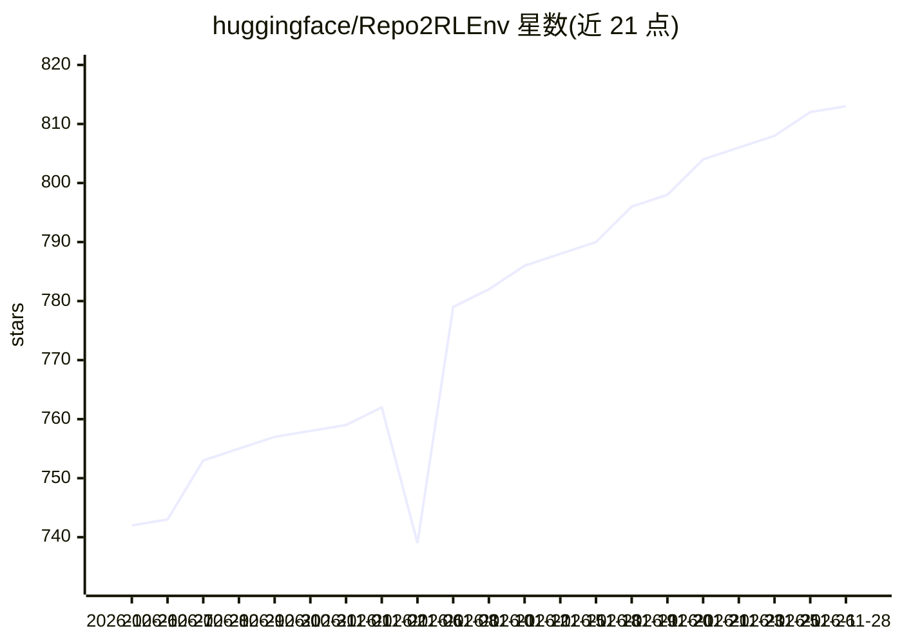

# huggingface/Repo2RLEnv

⭐ 813 · Python · Apache-2.0 · 推送 2026-11-25 · [GitHub](https://github.com/huggingface/Repo2RLEnv) · [官网](https://huggingface.github.io/Repo2RLEnv/) · 组织维护

**把代码仓库转成可训练可评测的 RL 环境任务**

Repo2RLEnv 将仓库、PR、agent 轨迹和任务种子转换为 Harbor 格式任务，每个任务包含 instruction、起始环境、verifier 与参考解；生成后经审查与校验器探测，任务带 unverified/verified/needs_repair/blocked 标签。内置 pr_diff、pr_runtime、Tasksmith 等多条流水线及 16 种研究配方。代码执行依赖本地 Docker 或 Modal/Daytona 工作节点，PR-diff 评分需模型裁判与 API key。以 PyPI 包发布，任务数据集可发布到 Hugging Face Hub。

## 筛选速览

| 维度 | 判定 | 备注 |
|---|---|---|
| AI 角色 | `ai-ecosystem` | LLM/agent 周边工具 |
| 许可风险 | `permissive` | Apache-2.0 |
| 部署形态 | `library` | 以包/库形式分发 |
| 模型依赖 | — | README 未给出锁定关系 |
| 硬件要求 | — | 无带数字的原话,不猜 |
| 安装摩擦 | `low` | 无编译、无系统依赖或容器化 |
| 成熟度 | — | 结构信号不足 |

## 能力要点

- 从 PR/轨迹/种子生成含 instruction、环境、verifier 与参考解的 Harbor 任务
- Tasksmith 用 LangGraph 驱动 agent 自动设计任务与校验器
- 内置 SWE-smith、R2E-Gym 等 16 种研究配方流水线
- 任务带统一质量标签，配套 FineEnvs 数据集集合

## 适用场景

- 为 coding agent 构建可训练的 RL 训练环境
- 从合并的 PR 或 agent 轨迹批量生成评测任务
- 在 Hugging Face Hub 上发布和分享任务数据集

## 场景标签

`模型评测` `强化学习` · 领域:评测与运维

## 证据(README 行号)

> L21: Repo2RLEnv turns repositories, pull requests, agent trajectories and task seeds into
> L24: Repo2RLEnv generates and reviews the tasks; Harbor runs agents against them.

## 星数曲线

2026-10-26 742 → 2026-11-28 813（+71）

---
*卡片 v1 · prompt 1.4 · 生成 2026-11-26 · 置信度 high · 依据 README sha `0bfdc5fbb4c6` · [字段定义](../../DATASET.md)*
