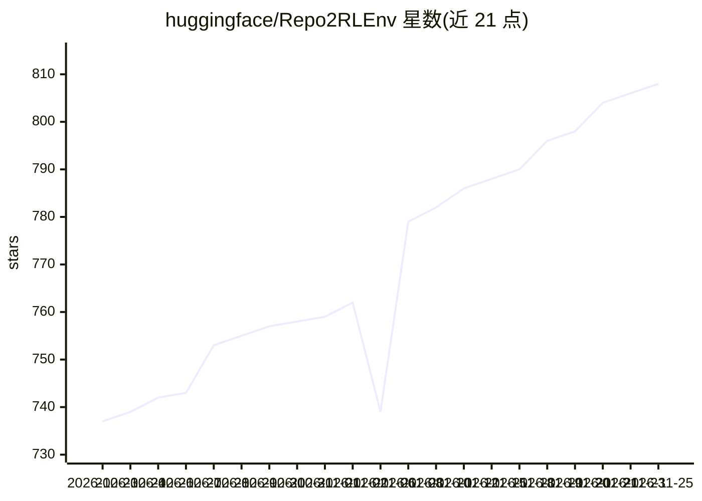

# huggingface/Repo2RLEnv

⭐ 808 · Python · Apache-2.0 · 推送 2026-11-23 · [GitHub](https://github.com/huggingface/Repo2RLEnv) · [官网](https://huggingface.github.io/Repo2RLEnv/) · 组织维护

**把任意代码仓库转成可验证 RL 环境，供 coding agent 训练评估**

Repo2RLEnv 从已合并的 PR、commit 历史、安全公告、库函数、终端录像等素材自动生成 Harbor 格式的 RL 任务环境，每个任务含指令、起始容器、私有验证器与参考解。提供 24 个生成器与 CLI，生成的任务可用任意 Harbor agent 运行评估，并可通过 push/pull 命令与 Hugging Face Hub 上的 21 个已发布数据集（1,930 个任务）互通。首条流水线仅需 Python 3.12+ 与 GitHub CLI，无需 Docker 与 LLM key；运行任务需 Docker，PR-diff 评分需 ANTHROPIC_API_KEY 作为 correctness judge。

## 筛选速览

| 维度 | 判定 | 备注 |
|---|---|---|
| AI 角色 | `ai-ecosystem` | LLM/agent 周边工具 |
| 许可风险 | `permissive` | Apache-2.0 |
| 部署形态 | `library` | 以包/库形式分发 |
| 模型依赖 | — | README 未给出锁定关系 |
| 硬件要求 | — | 无带数字的原话,不猜 |
| 安装摩擦 | `low` | 无编译、无系统依赖或容器化 |
| 成熟度 | — | 结构信号不足 |

## 能力要点

- 24 个生成器从 PR/commit/CVE/终端录像等素材产出 Harbor 任务
- 任务含指令、私有验证器与参考解，验证器写入 reward
- repo2rlenv push/pull 与 Hugging Face Hub 数据集互通
- Tasksmith 用 agent 自动调查仓库、设计指令并自修复直至验证通过

## 适用场景

- 为 coding agent 的 RL 训练批量生成带验证器的任务环境
- 用统一 Harbor 格式评估不同 agent 在真实仓库任务上的表现
- 把团队仓库的历史 PR 转成可复用的训练/评测集
- 在 Hugging Face Hub 上发布和获取 RL 任务数据集

## 场景标签

`模型评测` `强化学习` · 领域:评测与运维

## 证据(README 行号)

> L30: Harbor task you can train on, evaluate with
> L48: pip install 'repo2rlenv[harbor]'
> L166: pip install repo2rlenv                               # native pipelines and the CLI

## 星数曲线

2026-10-23 737 → 2026-11-25 808（+71）

---
*卡片 v1 · prompt 1.4 · 生成 2026-11-25 · 置信度 high · 依据 README sha `2f4b23eb9ee8` · [字段定义](../../DATASET.md)*
