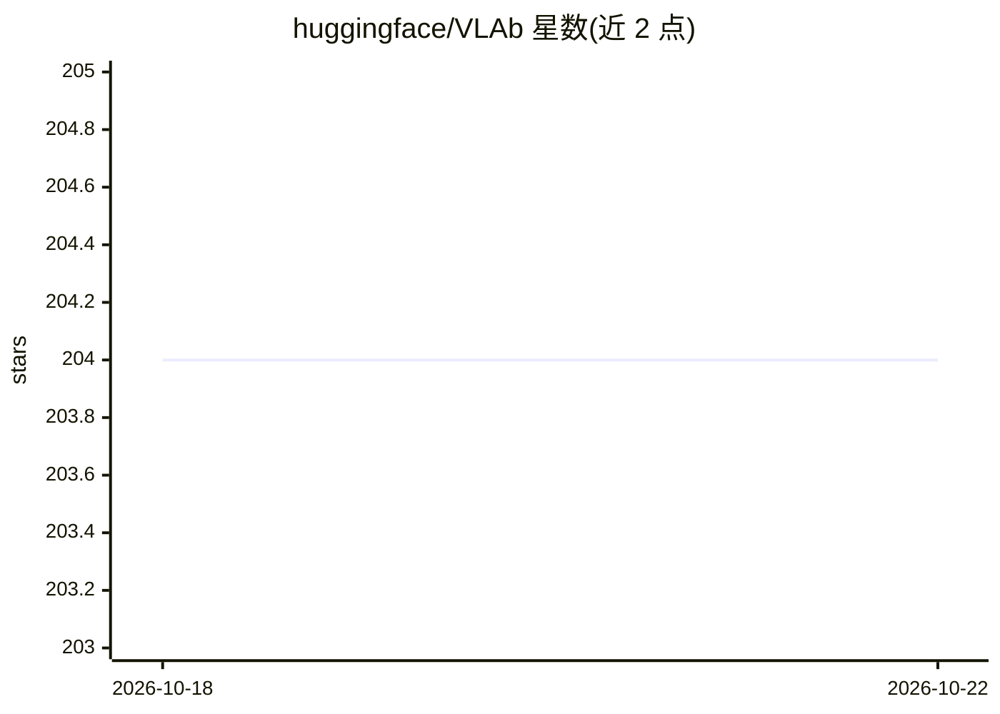

# huggingface/VLAb

⭐ 204 · Python · NOASSERTION · 推送 2025-11-19 · [GitHub](https://github.com/huggingface/VLAb) · 组织维护

**面向研究者的 VLA 模型预训练库，SmolVLA 官方复现套件**

从 LeRobot 派生的视觉-语言-动作（VLA）模型预训练库，专注在多 GPU 与 SLURM 集群上的高效预训练流程，可作为 SmolVLA 的官方复现套件（含接近原版的训练数据集、配置与流程）。支持多数据集同时训练与可配置采样策略，提供 conda 单命令环境创建、Accelerate 分布式训练配置与 SLURM 示例脚本。明确说明本库面向预训练优化，微调与推理建议迁移到 LeRobot，检查点因归一化格式变化可能不直接兼容。

## 筛选速览

| 维度 | 判定 | 备注 |
|---|---|---|
| AI 角色 | `ai-ecosystem` | LLM/agent 周边工具 |
| 许可风险 | `none` | NOASSERTION |
| 部署形态 | `None` |  |
| 模型依赖 | — | README 未给出锁定关系 |
| 硬件要求 | — | 无带数字的原话,不猜 |
| 安装摩擦 | `low` | 无编译、无系统依赖或容器化 |
| 成熟度 | — | 结构信号不足 |

## 能力要点

- SmolVLA 官方复现套件，含原始数据集、配置与工作流
- 经 Accelerate 支持多 GPU/多节点，已在单机与 SLURM 集群测试
- 多数据集同时训练与可配置采样策略
- 提供两个社区数据集（v1: 128 数据集/119.3GB，v2: 340 数据集/59GB）

## 适用场景

- 在多 GPU 或 SLURM 集群上预训练 VLA 模型
- 复现 SmolVLA 的预训练结果
- 在多个 HuggingFace 机器人数据集上混合采样训练

## 场景标签

 · 领域:机器人/具身智能

## 证据(README 行号)

> L7: A streamlined library for pretraining vision-language-action (VLA) models on robotics datasets. Derived from LeRobot
> L11: **VLAb** is designed for researchers who want to pretrain VLA models on HuggingFace datasets efficiently. It provid
> L16: - **Distributed Training**: Multi-GPU and multi-node support via Accelerate, tested on single machines and SLURM cl

## 星数曲线

2026-10-18 204 → 2026-10-22 204（+0）

---
*卡片 v1 · prompt 1.4 · 生成 2026-10-22 · 置信度 high · 依据 README sha `88ed6acc4c6e` · [字段定义](../../DATASET.md)*
