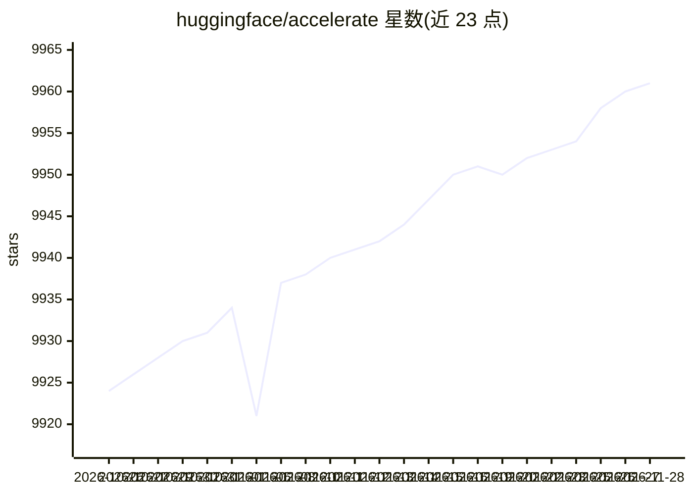

# huggingface/accelerate

⭐ 9,961 · Python · Apache-2.0 · 推送 2026-11-23 · [GitHub](https://github.com/huggingface/accelerate) · [官网](https://huggingface.co/docs/accelerate) · 组织维护

**为 PyTorch 开发者简化分布式与混合精度训练的库**

面向习惯手写 PyTorch 训练循环但不愿维护多 GPU/TPU/fp16 样板代码的用户：通过 Accelerator 类在原脚本上添加约 5 行代码，即可在单机、多机、CPU/GPU/TPU 及 fp8/fp16/bf16 混合精度配置下运行，同一代码可无需修改地本地调试或上训练环境。提供可选 CLI（accelerate config/launch）生成配置并启动脚本，支持 MPI、DeepSpeed、FSDP、Megatron-LM 集成与 notebook 启动。定位为薄封装而非高层框架，需用户自行编写训练循环。

## 筛选速览

| 维度 | 判定 | 备注 |
|---|---|---|
| AI 角色 | `ai-ecosystem` | LLM/agent 周边工具 |
| 许可风险 | `permissive` | Apache-2.0 |
| 部署形态 | `library` | 以包/库形式分发 |
| 模型依赖 | — | README 未给出锁定关系 |
| 硬件要求 | — | 无带数字的原话,不猜 |
| 安装摩擦 | `low` | 无编译、无系统依赖或容器化 |
| 成熟度 | — | 结构信号不足 |

## 能力要点

- 约 5 行改动即可适配单机/分布式与混合精度配置
- 可选 CLI 生成配置文件并统一启动脚本
- 支持 DeepSpeed/FSDP/Megatron-LM（实验性）与 fp8 混合精度
- notebook_launcher 支持 Colab/Kaggle TPU 后端

## 适用场景

- 把现有 PyTorch 训练脚本迁移到多 GPU/多机环境
- 在 Colab/Kaggle 的 TPU 上运行分布式训练
- 用统一配置在不同硬件环境间切换调试与训练

## 场景标签

`模型训练` · 领域:训练与推理

## 证据(README 行号)

> L10: 🤗 Accelerate was created for PyTorch users who like to write the training loop of PyTorch models but are reluctant 
> L40: 🤗 Accelerate also provides an optional CLI tool that allows you to quickly configure and test your training environ

## 星数曲线

2026-10-26 9,924 → 2026-11-28 9,961（+37）

---
*卡片 v1 · prompt 1.4 · 生成 2026-11-22 · 置信度 high · 依据 README sha `4c790b35ed7c` · [字段定义](../../DATASET.md)*
