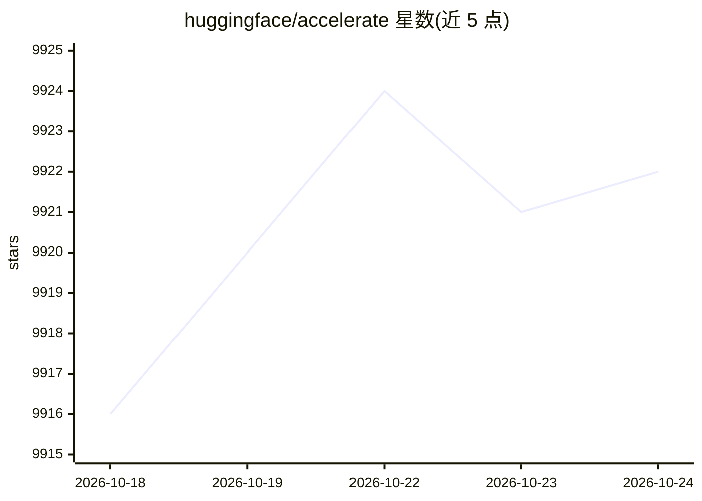

# huggingface/accelerate

⭐ 9,922 · Python · Apache-2.0 · 推送 2026-10-22 · [GitHub](https://github.com/huggingface/accelerate) · [官网](https://huggingface.co/docs/accelerate) · 组织维护

**让原生 PyTorch 训练脚本在任意设备/分布式配置上运行的轻量封装库**

面向喜欢自己编写训练循环、但不愿维护多 GPU/TPU/混合精度样板代码的 PyTorch 用户提供：Accelerate 以单个 Accelerator 类抽象设备放置与分布式相关样板代码，在标准训练脚本中加入数行即可运行于单/多 CPU、单/多 GPU、TPU 及 fp8/fp16/bf16 混合精度环境。提供 accelerate config/launch CLI、notebook_launcher，支持 DeepSpeed、FSDP、Megatron-LM（均标注实验性）。要求 Python 3.8+、PyTorch 1.10.0+，pip 安装。

## 筛选速览

| 维度 | 判定 | 备注 |
|---|---|---|
| AI 角色 | `ai-ecosystem` | LLM/agent 周边工具 |
| 许可风险 | `permissive` | Apache-2.0 |
| 部署形态 | `library` | 以包/库形式分发 |
| 模型依赖 | — | README 未给出锁定关系 |
| 硬件要求 | `cpu-ok` | |
| 安装摩擦 | `low` | 无编译、无系统依赖或容器化 |
| 成熟度 | `idea` | |

## 能力要点

- Accelerator 单类 API，训练脚本仅需少量改动即可跨 CPU/GPU/TPU 运行
- 支持 fp8/fp16/bf16 混合精度
- DeepSpeed / FSDP / Megatron-LM 集成（实验性）
- 提供 accelerate config 与 accelerate launch CLI 及 notebook_launcher

## 适用场景

- 让本地调试与分布式训练用同一份代码
- 在多 GPU 或 TPU 环境启动自己的 PyTorch 训练脚本
- 在 Colab/Kaggle notebook 中启动分布式训练

## 场景标签

`模型训练` · 领域:训练与推理

## 证据(README 行号)

> L10: 🤗 Accelerate was created for PyTorch users who like to write the training loop of PyTorch models but are reluctant 
> L117: You should use 🤗 Accelerate when you want to easily run your training scripts in a distributed environment without

## 星数曲线

2026-10-18 9,916 → 2026-10-24 9,922（+6）

---
*卡片 v1 · prompt 1.4 · 生成 2026-10-20 · 置信度 high · 依据 README sha `182ecf6db47b` · [字段定义](../../DATASET.md)*
