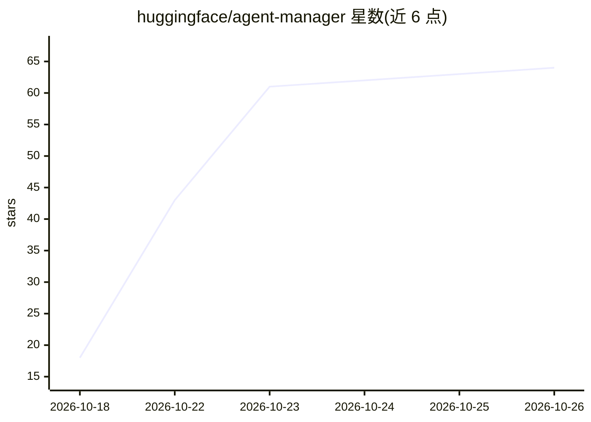

# huggingface/agent-manager

⭐ 64 · JavaScript · Apache-2.0 · 推送 2026-10-23 · [GitHub](https://github.com/huggingface/agent-manager) · 组织维护

**在浏览器中集中管理多个 AI 编程 CLI 会话的私有工作区**

部署在 Hugging Face Docker Space 上的自托管应用：在统一界面中运行 Claude Code、Codex、Gemini CLI、opencode、Hermes、OpenClaw、fx 等编程 agent，支持按项目分组并排查看多个会话、在终端与对话阅读器之间切换、浏览编辑工作区文件、统一管理可复用 skills、查看 token 用量与费用估算、定时执行 prompt，并可连接远程机器上的 agent。通过挂载在 /data 的私有存储桶持久化文件、登录状态与会话历史。应用自身无登录机制，需保持 Space 与存储桶私有。

## 筛选速览

| 维度 | 判定 | 备注 |
|---|---|---|
| AI 角色 | `ai-ecosystem` | LLM/agent 周边工具 |
| 许可风险 | `permissive` | Apache-2.0 |
| 部署形态 | `library` | 以包/库形式分发 |
| 模型依赖 | — | README 未给出锁定关系 |
| 硬件要求 | — | 无带数字的原话,不猜 |
| 安装摩擦 | `low` | 无编译、无系统依赖或容器化 |
| 成熟度 | — | 结构信号不足 |

## 能力要点

- 并排运行与管理 7 种编程 agent CLI 会话，支持跨设备接续
- 私有存储桶挂载 /data 持久化文件、登录与会话历史
- 会话间共享 skills、本地 API 互访与共享文件夹
- token 用量/费用查看与定时 prompt、设备通知

## 适用场景

- 同时跟进多个 AI 编程 agent 的任务并排监控
- 跨设备接续浏览器中的 agent 会话
- 让多个 agent 共享上下文与文件协同做同一项目

## 场景标签

 · 领域:开发者工具/AI agent 管理

## 证据(README 行号)

> L16: Run Claude Code, Codex, Gemini CLI, opencode, Hermes, OpenClaw and fx from your
> L39: - **Give agents shared context.** Manage reusable skills in one place and let

## 星数曲线

2026-10-18 18 → 2026-10-26 64（+46）

---
*卡片 v1 · prompt 1.4 · 生成 2026-10-24 · 置信度 mid · 依据 README sha `0461cb73d0ff` · [字段定义](../../DATASET.md)*
