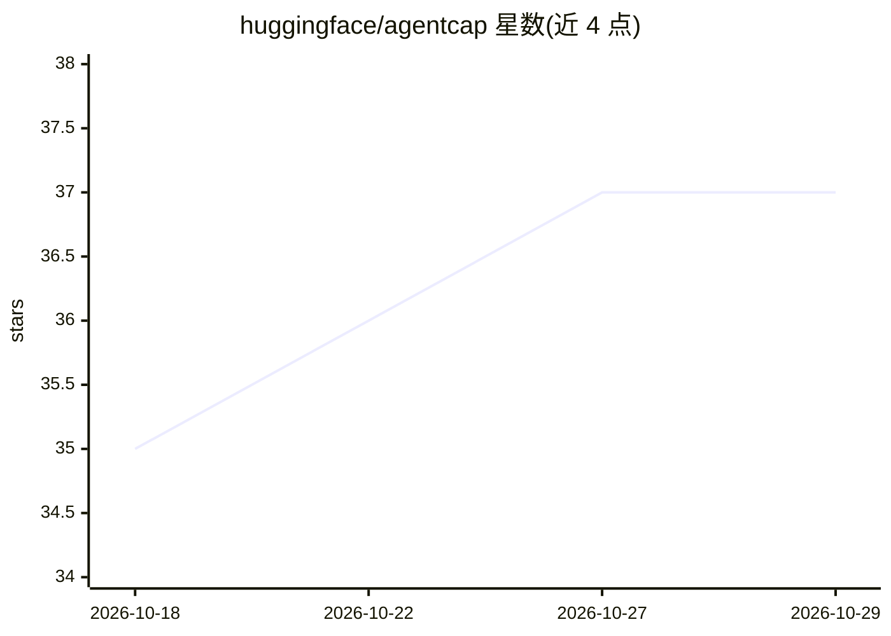

# huggingface/agentcap

⭐ 37 · Rust · Apache-2.0 · 推送 2026-10-14 · [GitHub](https://github.com/huggingface/agentcap) · 组织维护

**采集、分析并导出编码 agent 会话的运行框架**

端到端工具链：在 `(agent × model × corpus)` 组合下批量运行真实编码 agent（沙箱内经 podman），通过捕获代理截取每个 chat-completion 请求/响应（解析后的 JSON 与原始 SSE 字节），导出为 parquet 并作为 Hugging Face 数据集发布，供渲染、分析与复现。提供 `run / export / inspect` 三个子命令与三层浏览界面；本地模型服务可用 llama.cpp 或 `transformers serve`。Rust 实现，以二进制安装脚本或 cargo 构建。

## 筛选速览

| 维度 | 判定 | 备注 |
|---|---|---|
| AI 角色 | `ai-ecosystem` | LLM/agent 周边工具 |
| 许可风险 | `permissive` | Apache-2.0 |
| 部署形态 | `library` | 以包/库形式分发 |
| 模型依赖 | — | README 未给出锁定关系 |
| 硬件要求 | — | 无带数字的原话,不猜 |
| 安装摩擦 | `medium` | 含编译或系统依赖之一 |
| 成熟度 | — | 结构信号不足 |

## 能力要点

- 按 agent×model×corpus 组合批量运行编码 agent 并捕获完整会话
- 捕获代理逐字节记录 chat-completion 请求与 SSE 流式响应
- 导出 parquet + 原生 trace，成对发布为 HF 数据集
- `agentcap inspect` 提供 parquet → request → message 的浏览链

## 适用场景

- 系统化对比不同 agent 与模型组合的真实交互数据
- 把 agent 会话固化为可复现、可分析的数据集发布到 Hub
- 无需从日志重建即可复盘 agent 实际发送与收到的内容

## 场景标签

`模型评测` · 领域:评测与运维

## 证据(README 行号)

> L3: An end-to-end harness for running real coding agents at scale across
> L6: the agent through a corpus of prompts, captures every chat-completion
> L8: streamed responses as raw SSE bytes), and pushes the result to the

## 星数曲线

2026-10-18 35 → 2026-10-29 37（+2）

---
*卡片 v1 · prompt 1.4 · 生成 2026-10-25 · 置信度 high · 依据 README sha `435f3f401f1c` · [字段定义](../../DATASET.md)*
