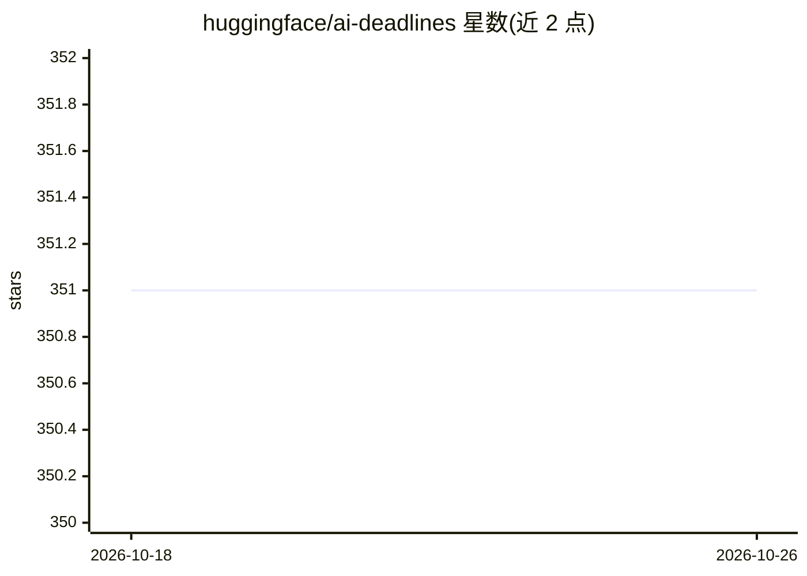

# huggingface/ai-deadlines

⭐ 351 · TypeScript · MIT · 推送 2026-09-23 · [GitHub](https://github.com/huggingface/ai-deadlines) · [官网](https://huggingface.co/spaces/huggingface/ai-deadlines) · 组织维护

**面向科研人员的 AI 顶会投稿截止日期倒计时网页应用**

展示 NeurIPS、ICLR 等 AI 顶会投稿截止日期的 Web 应用，由 Hugging Face 托管于 Spaces，基于已停止维护的 paperswithcode/ai-deadlines 重建并更新 UI。会议数据由 AI Agent 定期自动抓取并以 pull request 方式更新，也接受社区通过修改 src/data/conferences/ 下 YAML 文件贡献条目。技术栈为 Vite/TypeScript/React，支持 Node.js 本地运行、Docker 部署及 Google Cloud Run 云部署，MIT 许可。

## 筛选速览

| 维度 | 判定 | 备注 |
|---|---|---|
| AI 角色 | `ai-knowledge` | 知识聚合/清单类 |
| 许可风险 | `permissive` | MIT |
| 部署形态 | `self-host` | docker 或自建部署 |
| 模型依赖 | — | README 未给出锁定关系 |
| 硬件要求 | — | 无带数字的原话,不猜 |
| 安装摩擦 | `low` | 无编译、无系统依赖或容器化 |
| 成熟度 | — | 结构信号不足 |

## 能力要点

- 展示 AI 顶会多个截止日期倒计时，支持 AoE/IANA 时区等格式
- 会议数据由 AI Agent 定期抓取并自动提交 pull request 更新
- 提供 Docker 构建与 Cloud Run 云部署路径
- 基于 Vite/TypeScript/React，数据文件为社区可编辑的 YAML

## 适用场景

- 快速查看目标会议的投稿截止日期
- 跟踪多个 AI 会议的 upcoming 时间节点
- 社区协作维护会议数据条目

## 场景标签

`科研工具` · 领域:学习与行业

## 证据(README 行号)

> L11: A web app to quickly see submission deadlines to top AI conferences, such as NeurIPS and ICLR.
> L25: New data is automatically fetched by AI Agents, which regularly open pull requests. See the agents folder for detai

## 星数曲线

2026-10-18 351 → 2026-10-26 351（+0）

---
*卡片 v1 · prompt 1.4 · 生成 2026-10-21 · 置信度 mid · 依据 README sha `f4ca3f8f427e` · [字段定义](../../DATASET.md)*
