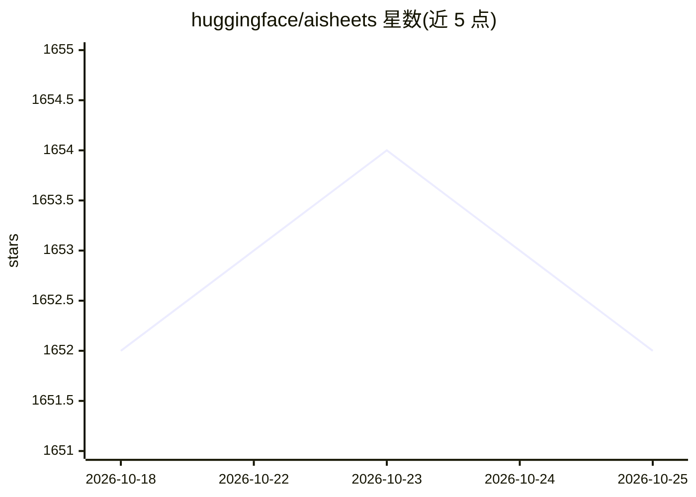

# huggingface/aisheets

⭐ 1,653 · TypeScript · Apache-2.0 · 推送 2026-09-23 · [GitHub](https://github.com/huggingface/aisheets) · [官网](https://huggingface.co/spaces/aisheets/sheets) · 组织维护

**无代码构建与增广数据集的 AI 电子表格工具**

Hugging Face 开源的电子表格式工具，用 AI 模型构建、增广和变换数据集：通过 Inference Providers 访问 Hub 上数千个开放模型，或经 OpenAI 兼容端点接入自定义/本地 LLM（如 Ollama、LM Studio）。支持 Docker、pnpm 源码部署或 Hub Space 在线试用；可配合 HF Jobs 和 vllm 脚本批量生成数据。限制：文生图功能固定走 Inference Providers，暂不可自定义。

## 筛选速览

| 维度 | 判定 | 备注 |
|---|---|---|
| AI 角色 | `ai-native` | 本体是模型或模型工具 |
| 许可风险 | `permissive` | Apache-2.0 |
| 部署形态 | `self-host` | docker 或自建部署 |
| 模型依赖 | local-ok | 支持本地模型 |
| 硬件要求 | — | 无带数字的原话,不猜 |
| 安装摩擦 | `low` | 无编译、无系统依赖或容器化 |
| 成熟度 | — | 结构信号不足 |

## 能力要点

- 电子表格界面用 AI 模型生成/变换/增广数据集，无需代码
- 默认经 Hugging Face Inference Providers 调用开放模型
- 支持 OpenAI API 兼容的自定义端点（Ollama 等）
- 提供基于 HF Jobs 与 vllm 的大规模数据生成脚本

## 适用场景

- 不写代码就给数据集增加 AI 生成的列/内容
- 用本地 Ollama 模型生成或变换数据
- 配合 HF Jobs 批量生成合成数据集

## 场景标签

`图像生成` · 领域:内容生成

## 证据(README 行号)

> L3: *Build, enrich, and transform datasets using AI models with no code. Deploy locally or on the Hub with access to tho
> L11: Hugging Face AI Sheets is an open-source tool for building, enriching, and transforming datasets using AI models wi

## 星数曲线

2026-10-18 1,652 → 2026-10-25 1,652（+0）

---
*卡片 v1 · prompt 1.4 · 生成 2026-10-21 · 置信度 high · 依据 README sha `84f49df5523d` · [字段定义](../../DATASET.md)*
