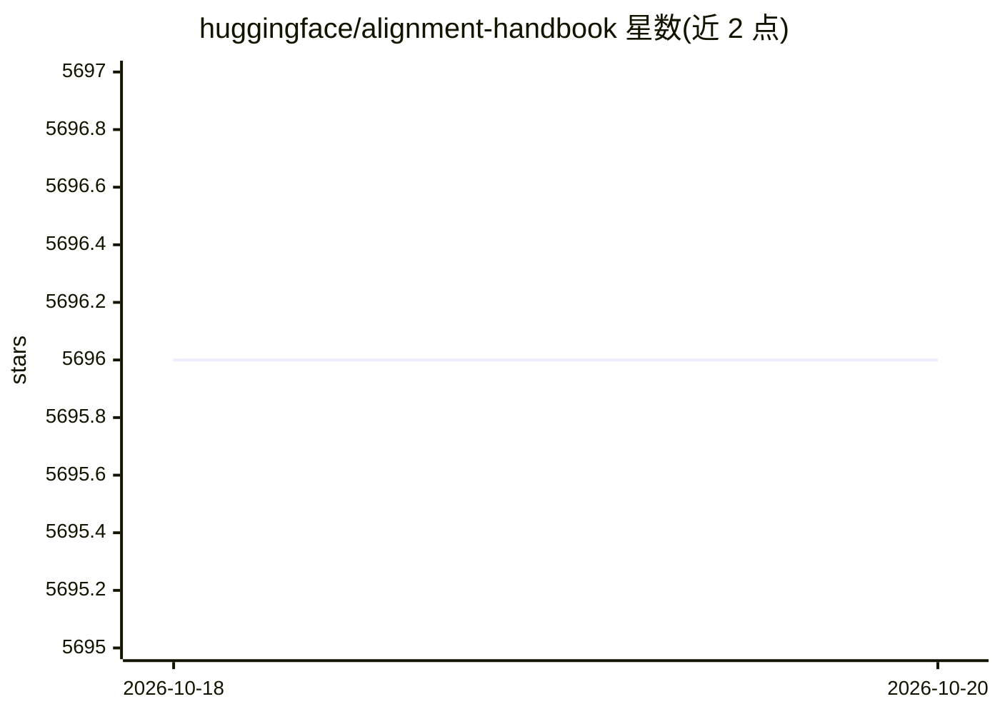

# huggingface/alignment-handbook

⭐ 5,696 · Python · Apache-2.0 · 推送 2026-09-23 · [GitHub](https://github.com/huggingface/alignment-handbook) · [官网](https://huggingface.co/HuggingFaceH4) · 组织维护

**HF 官方的大模型对齐训练配方库：SFT/DPO/ORPO 全流程复现**

Hugging Face 团队维护的语言模型对齐训练手册与代码库：提供覆盖继续预训练、SFT、DPO、ORPO 四步的训练脚本，支持 DeepSpeed ZeRO-3 分布式全参训练与 LoRA/QLoRA 高效微调；以 YAML 配方文件形式发布 Zephyr、SmolLM、StarChat2 等模型的可复现训练参数。面向需要训练或复现对话/对齐模型的开发与研究人员。安装基于 uv + PyTorch 2.6.0 + Flash Attention 2，并需 HF 账号与 Git LFS。

## 筛选速览

| 维度 | 判定 | 备注 |
|---|---|---|
| AI 角色 | `ai-ecosystem` | LLM/agent 周边工具 |
| 许可风险 | `permissive` | Apache-2.0 |
| 部署形态 | `library` | 以包/库形式分发 |
| 模型依赖 | — | README 未给出锁定关系 |
| 硬件要求 | — | 无带数字的原话,不猜 |
| 安装摩擦 | `medium` | 含编译或系统依赖之一 |
| 成熟度 | — | 结构信号不足 |

## 能力要点

- 继续预训练→SFT→DPO/ORPO 的四步全流程训练脚本
- DeepSpeed ZeRO-3 分布式与 LoRA/QLoRA 参数高效微调支持
- YAML 配方文件复现 Zephyr/SmolLM 等模型训练
- 含 gpt2-nl 配方示例，可用于语言/领域适配

## 适用场景

- 按配方复现 Zephyr 等对齐模型的完整训练
- 在自己的数据集上做 SFT 与偏好对齐训练
- 将配方迁移到其他语言或领域做继续预训练

## 场景标签

`微调` `模型训练` `强化学习` · 领域:训练与推理

## 证据(README 行号)

> L34: * `scripts` to train and evaluate models. Four steps are included: continued pretraining, supervised-finetuning (SF
> L35: * `recipes` to reproduce models like Zephyr 7B. Each recipe takes the form of a YAML file which contains all the pa

## 星数曲线

2026-10-18 5,696 → 2026-10-20 5,696（+0）

---
*卡片 v1 · prompt 1.4 · 生成 2026-10-20 · 置信度 high · 依据 README sha `bd67c9b08b72` · [字段定义](../../DATASET.md)*
