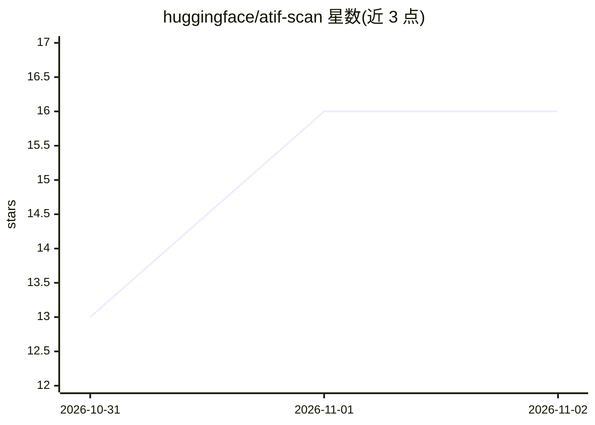

# huggingface/atif-scan

⭐ 16 · Python · MIT · 推送 2026-10-31 · [GitHub](https://github.com/huggingface/atif-scan) · 组织维护

**离线扫描 ATIF agent 轨迹、输出作弊审查候选的工具**

对 ATIF 格式的 agent 轨迹做静态分析的 Python CLI：核心仅用标准库、离线运行，不执行轨迹中的内容，默认不调用模型（可选 --image-model）。提供检测器与规则标记基准意识、reward hacking、异常时间戳等审查线索，配套 allowances 机制标注预期内行为，支持从本地目录、Hugging Face、Harbor 拉取与镜像缓存，可生成 judge 提示词并通过只读 MCP Server 安全访问轨迹。面向 agent 基准评测的审查与验证工作。

## 筛选速览

| 维度 | 判定 | 备注 |
|---|---|---|
| AI 角色 | `ai-ecosystem` | LLM/agent 周边工具 |
| 许可风险 | `permissive` | MIT |
| 部署形态 | `library` | 以包/库形式分发 |
| 模型依赖 | — | README 未给出锁定关系 |
| 硬件要求 | — | 无带数字的原话,不猜 |
| 安装摩擦 | `low` | 无编译、无系统依赖或容器化 |
| 成熟度 | — | 结构信号不足 |

## 能力要点

- 检测器+规则+allowances 的分层审查机制，findings 标记为 review candidates 而非定论
- 核心为标准库 Python、离线确定性分析，不执行轨迹内容
- 支持 hf:// 与 harbor:// 输入并私有镜像缓存增量重扫
- 可生成 judge prompts，默认引擎 fast-agent，提供只读 MCP Server

## 适用场景

- 审查 agent 基准运行轨迹中的 reward hacking 与基准意识行为
- 为已知基准任务（tb-21、deepswe 等）标注 allowances 并计算得分
- 生成 judge 提示词以调优检测器与验证审查结果

## 场景标签

`模型评测` · 领域:评测与运维

## 证据(README 行号)

> L3: Plugin-style detectors and simple rules over ATIF agent trajectories. The analysis core
> L16:  - Cheap deterministic checks for benchmark awareness, reward hacking etc.
> L19:  - Generate prompts for judging/inspecting traces - read-only MCP Server provides safe access to benchmark traces.

## 星数曲线

2026-10-31 13 → 2026-11-02 16（+3）

---
*卡片 v1 · prompt 1.4 · 生成 2026-10-31 · 置信度 high · 依据 README sha `e1ab4467097f` · [字段定义](../../DATASET.md)*
