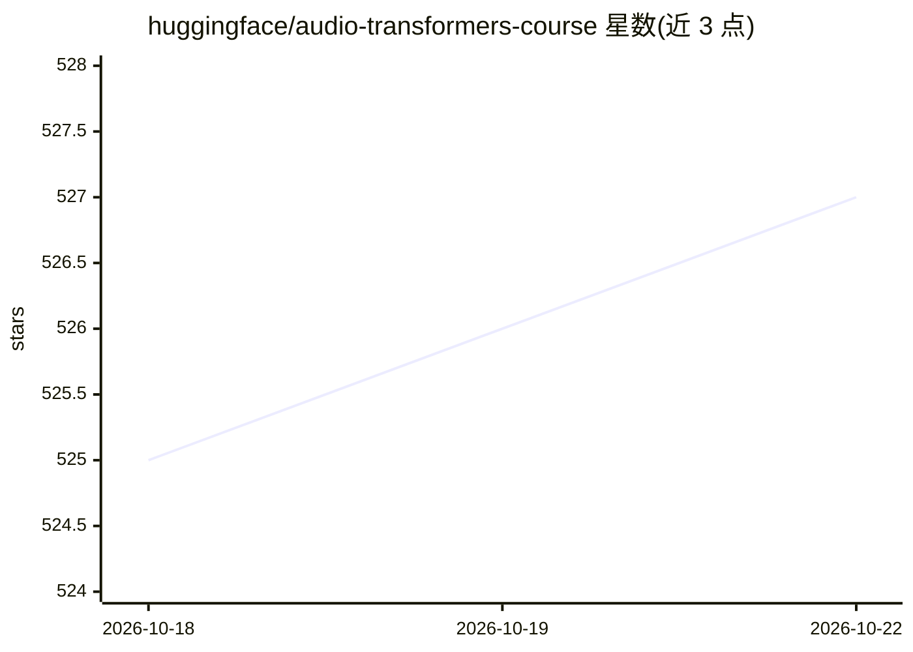

# huggingface/audio-transformers-course

⭐ 528 · MDX · Apache-2.0 · 推送 2026-10-06 · [GitHub](https://github.com/huggingface/audio-transformers-course) · 组织维护 · 中文 README

**面向学习者的 Transformers 音频处理免费开源课程**

Hugging Face 官方维护的音频 Transformers 课程内容仓库：讲解将 Transformers 应用于语音与音频处理各类任务，内容以 chapters 目录下的 MDX 文本与代码片段组织，配套 Colab notebooks 与本地预览工具（hf-doc-builder）。课程免费开源，提供 8 种语言版本（含简体中文 zh-CN），并接受社区翻译贡献；README 附完整的翻译流程与本地构建说明，但新章节目前不接受社区投稿。

## 筛选速览

| 维度 | 判定 | 备注 |
|---|---|---|
| AI 角色 | `ai-knowledge` | 知识聚合/清单类 |
| 许可风险 | `permissive` | Apache-2.0 |
| 部署形态 | `library` | 以包/库形式分发 |
| 模型依赖 | — | README 未给出锁定关系 |
| 硬件要求 | — | 无带数字的原话,不猜 |
| 安装摩擦 | `low` | 无编译、无系统依赖或容器化 |
| 成熟度 | — | 结构信号不足 |

## 能力要点

- 课程内容以 MDX 文件组织，配套 Colab notebooks
- 支持 8 种语言版本，含社区翻译流程（issue→fork→PR）
- 提供 hf-doc-builder 本地预览与 generate_notebooks.py 生成脚本

## 适用场景

- 学习 Transformers 在音频与语音处理中的应用
- 参与课程的多语言翻译贡献
- 本地预览或生成课程代码 notebooks

## 场景标签

`教程课程` · 领域:学习与行业

## 证据(README 行号)

> L3: This repo contains the content that's used to create Hugging Face's Audio Transformers Course.
> L4: The course teaches you about applying Transformers to various tasks in audio and speech processing.It's completely f

## 星数曲线

2026-10-18 525 → 2026-10-22 527（+2）

---
*卡片 v1 · prompt 1.4 · 生成 2026-10-21 · 置信度 mid · 依据 README sha `8d2f79dcd8b8` · [字段定义](../../DATASET.md)*
