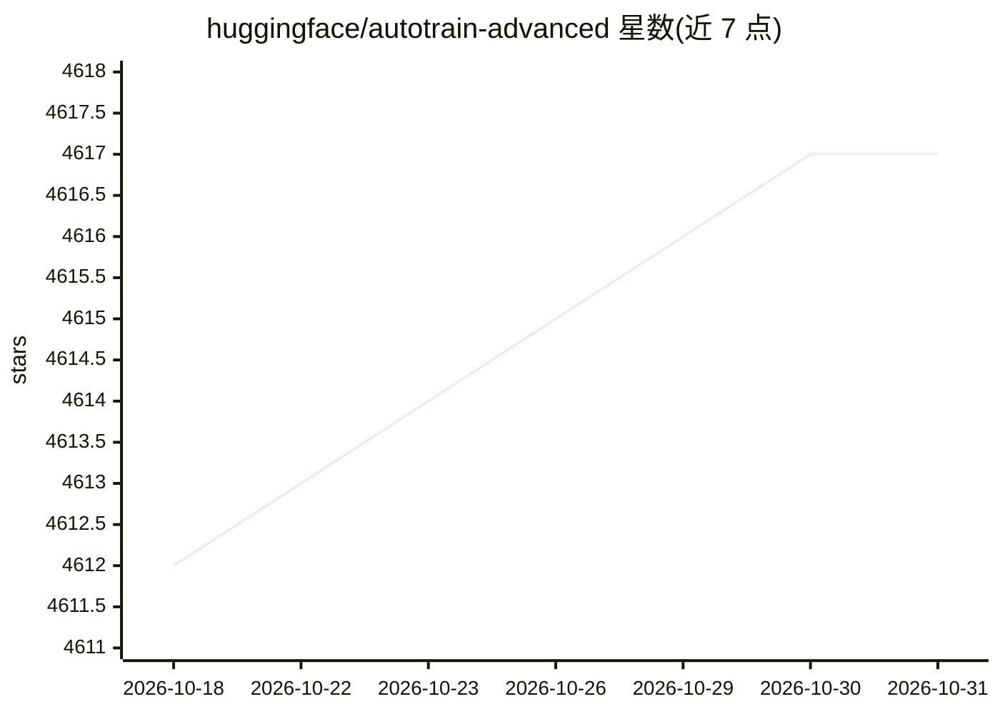

# huggingface/autotrain-advanced

⭐ 4,617 · Python · Apache-2.0 · 推送 2026-10-29 · [GitHub](https://github.com/huggingface/autotrain-advanced) · [官网](https://huggingface.co/autotrain) · 组织维护

**无代码训练部署机器学习模型的工具，已停止维护**

HuggingFace 维护的无代码（no-code）模型训练工具：通过 UI 或 CLI/config 文件训练 LLM SFT/DPO/ORPO/Reward 微调、文本分类/回归、图像分类等任务模型，可在 Colab、Hugging Face Spaces 或本地基础设施运行，本地仅需 pip 安装并依赖 git lfs 与 torch 系列库。注意：README 顶部声明项目不再维护，建议改用 Axolotl、TRL 或 transformers.Trainer。

## 筛选速览

| 维度 | 判定 | 备注 |
|---|---|---|
| AI 角色 | `ai-ecosystem` | LLM/agent 周边工具 |
| 许可风险 | `permissive` | Apache-2.0 |
| 部署形态 | `library` | 以包/库形式分发 |
| 模型依赖 | — | README 未给出锁定关系 |
| 硬件要求 | — | 无带数字的原话,不猜 |
| 安装摩擦 | `medium` | 含编译或系统依赖之一 |
| 成熟度 | — | 结构信号不足 |

## 能力要点

- 支持 LLM SFT/DPO/ORPO/Reward 等微调任务及文本/图像任务
- UI（autotrain app）与 CLI/config 文件两种使用方式
- 可在 Hugging Face Spaces、Colab 或本地基础设施运行

## 适用场景

- 无需写训练代码，用 UI 几步点击完成模型微调
- 用 YAML config 通过命令行批量跑微调实验
- 在 Colab 或 Spaces 上快速部署训练界面

## 场景标签

`微调` · 领域:训练与推理

## 证据(README 行号)

> L6: AutoTrain Advanced: faster and easier training and deployments of state-of-the-art machine learning models. AutoTrai
> L56: If you are not fond of UI, you can use AutoTrain Configs to train using command line or simply AutoTrain CLI.

## 星数曲线

2026-10-18 4,612 → 2026-10-31 4,617（+5）

---
*卡片 v1 · prompt 1.4 · 生成 2026-10-20 · 置信度 high · 依据 README sha `2929a792ffab` · [字段定义](../../DATASET.md)*
