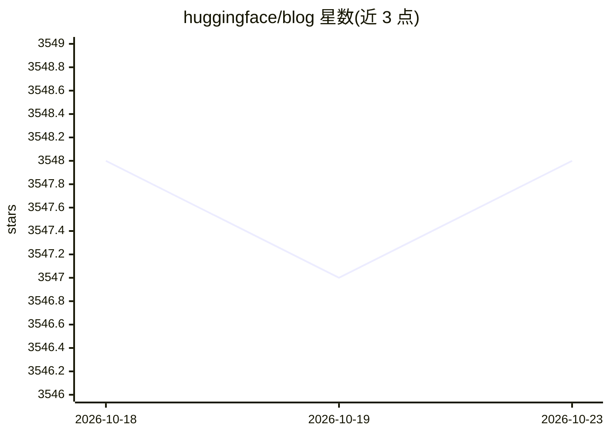

# huggingface/blog

⭐ 3,548 · Jupyter Notebook · 推送 2026-10-22 · [GitHub](https://github.com/huggingface/blog) · [官网](https://hf.co/blog) · 组织维护

**Hugging Face 官方博客文章仓库：博客投稿与发布流程**

存放 Hugging Face 官方博客文章 Markdown 源文件的仓库。README 面向博客作者，说明写作与发布流程：创建分支、新建 md 文件（文件名即文章 URL）、在 assets 放缩略图、其余图片镜像到文档图片仓库以减小仓库体积，按模板填写 title/thumbnail/authors，更新 _blog.yml 后提 PR，合并后自动发布。另说明缩略图制作（1300x650）、LaTeX 公式与图表 caption 的写法。

## 筛选速览

| 维度 | 判定 | 备注 |
|---|---|---|
| AI 角色 | `ai-knowledge` | 知识聚合/清单类 |
| 许可风险 | `none` | — |
| 部署形态 | `None` |  |
| 模型依赖 | — | README 未给出锁定关系 |
| 硬件要求 | — | 无带数字的原话,不猜 |
| 安装摩擦 | `low` | 无编译、无系统依赖或容器化 |
| 成熟度 | — | 结构信号不足 |

## 能力要点

- Markdown 文件名直接作为博客文章 URL
- 合并 PR 后文章自动发布
- 非 HF 合作文章引导至社区博客渠道

## 适用场景

- 为 Hugging Face 博客撰写并投稿文章
- 查看官方博客文章的源文件与排版写法

## 场景标签

 · 领域:AI 公司官方博客/内容

## 证据(README 行号)

> L2: This is the official repository of the Hugging Face Blog.
> L42: 8️⃣ The article will be **published automatically when you merge your pull request**.

## 星数曲线

2026-10-18 3,548 → 2026-10-23 3,548（+0）

---
*卡片 v1 · prompt 1.4 · 生成 2026-10-20 · 置信度 high · 依据 README sha `8e8d81070d0e` · [字段定义](../../DATASET.md)*
