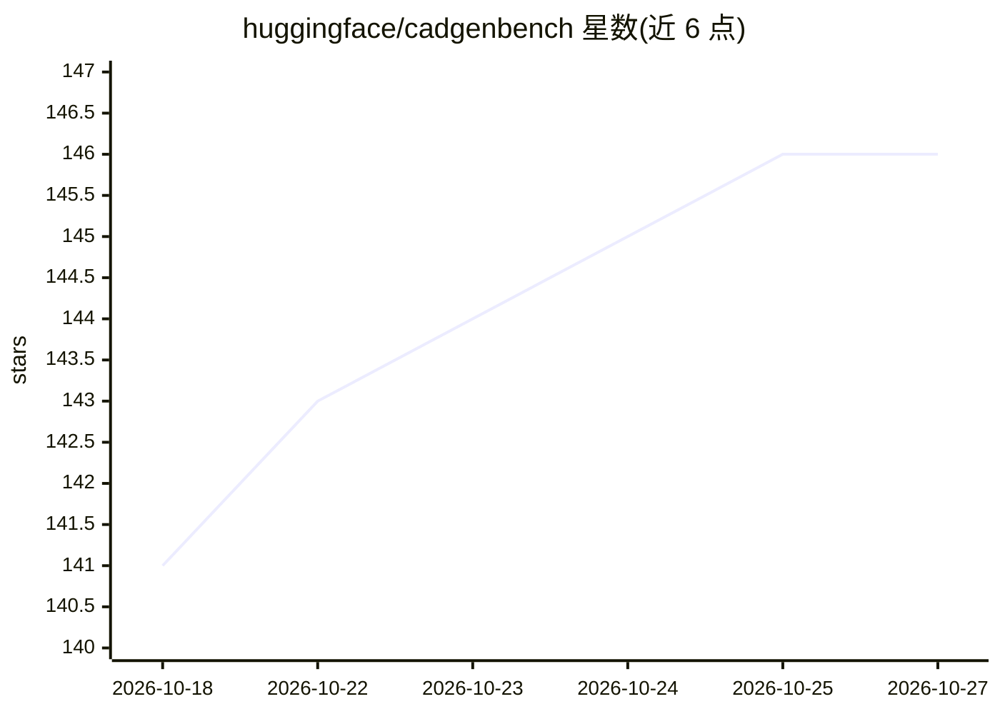

# huggingface/cadgenbench

⭐ 146 · Python · Apache-2.0 · 推送 2026-10-22 · [GitHub](https://github.com/huggingface/cadgenbench) · [官网](https://huggingface.co/spaces/HuggingAI4Engineering/cadgenbench-leaderboard) · 组织维护

**评测 AI 生成与编辑 CAD 机械零件能力的基准**

HuggingFace 维护的 CAD 生成基准：包含从工程图生成几何正确的 3D 模型、以及按需求编辑既有 STEP 文件两项任务。评测与工具无关，参赛者只需对每个样本提交一个 STEP/BREP 候选文件，在 HF Space 上对照私有 ground truth 打分，指标含有效性、形状相似度、接口匹配与拓扑匹配，合成 CAD Score 并发布榜单。本仓库提供评分引擎源码、文档与可选的参考基线：一个迭代写 build123d/CadQuery 代码并自检的 agent，经 LiteLLM 接入多种 LLM，Python 3.12 环境下 pip 安装。参与评测本身无需安装本仓库。

## 筛选速览

| 维度 | 判定 | 备注 |
|---|---|---|
| AI 角色 | `ai-ecosystem` | LLM/agent 周边工具 |
| 许可风险 | `permissive` | Apache-2.0 |
| 部署形态 | `None` |  |
| 模型依赖 | — | README 未给出锁定关系 |
| 硬件要求 | — | 无带数字的原话,不猜 |
| 安装摩擦 | `low` | 无编译、无系统依赖或容器化 |
| 成熟度 | — | 结构信号不足 |

## 能力要点

- 工具无关的提交契约：每样本一个 output.step，Space 端统一打分
- 四轴指标（有效性门控/形状相似度/接口匹配/拓扑匹配）合成 CAD Score
- 参考基线为迭代写 build123d/CadQuery 代码并自我验证的 agent
- 基线经 LiteLLM 支持任意 provider/model 字符串

## 适用场景

- 评估我的 CAD 生成/编辑 agent 在机械零件任务上的表现
- 以参考基线为起点搭建自己的 CAD 生成器
- 在公开榜单上对比不同系统的 CAD Score

## 场景标签

`模型评测` · 领域:评测与运维

## 证据(README 行号)

> L8: **CADGenBench** measures how well AI systems produce correct 3D
> L31: - **Scoring engine** (`src/cadgenbench/eval/`): the CAD Score pipeline

## 星数曲线

2026-10-18 141 → 2026-10-27 146（+5）

---
*卡片 v1 · prompt 1.4 · 生成 2026-10-22 · 置信度 high · 依据 README sha `140c65654629` · [字段定义](../../DATASET.md)*
