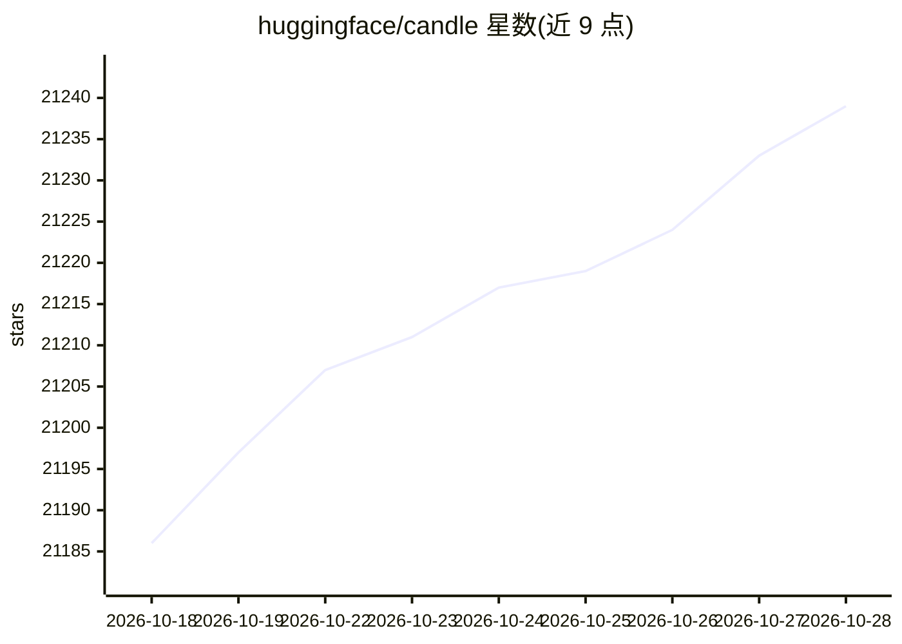

# huggingface/candle

⭐ 21,239 · Rust · Apache-2.0 · 推送 2026-10-14 · [GitHub](https://github.com/huggingface/candle) · 组织维护

**面向 Rust 开发者的极简机器学习框架，支持 GPU 与浏览器推理**

用 Rust 实现的机器学习框架，提供 Tensor 定义、CPU/CUDA/WASM 后端、模型训练与量化加载（safetensors、npz、ggml、PyTorch 文件）。内置大量模型示例，覆盖文本生成、语音识别、图像分割、文生图等任务；部分演示可编译为 WASM 在浏览器中运行。设计目标为 serverless 推理与去除生产环境中的 Python 依赖，输出轻量二进制。以 cargo crate 分发，含 core、nn、datasets、transformers 等子模块。

## 筛选速览

| 维度 | 判定 | 备注 |
|---|---|---|
| AI 角色 | `ai-ecosystem` | LLM/agent 周边工具 |
| 许可风险 | `permissive` | Apache-2.0 |
| 部署形态 | `desktop` | 安装包/桌面程序 |
| 模型依赖 | local-ok | 支持本地模型 |
| 硬件要求 | — | 无带数字的原话,不猜 |
| 安装摩擦 | `low` | 无编译、无系统依赖或容器化 |
| 成熟度 | — | 结构信号不足 |

## 动量与使用信号

- 维护:`active` — 距上次 push 3.9 天,年发版 0,284 位贡献者
- 涨星:近 1 天 **+10**(自 20261016 起算)
- 平台:— · 协议:OPENAI-API

## 能力要点

- CPU（可选 MKL/Accelerate）、CUDA（NCCL 多卡）与 WASM 三类后端
- 加载 safetensors/npz/ggml/PyTorch 文件格式，支持 llama.cpp 量化类型
- 内置 LLM、文生图、语音、视觉等大量模型示例，浏览器端 WASM 演示
- 语法对齐 PyTorch 的 cheatsheet，含 ONNX 评估子模块 candle-onnx

## 适用场景

- 在 Rust 生产环境中部署不依赖 Python 的模型推理
- 把 whisper、LLaMA2 等模型编译为 WASM 在浏览器运行
- 在 serverless/CPU 环境部署轻量推理二进制

## 场景标签

`推理引擎` · 领域:训练与推理

## 证据(README 行号)

> L8: Candle is a minimalist ML framework for Rust with a focus on performance (including GPU support)
> L183: - Simple syntax, looks and feels like PyTorch.
> L269: Candle's core goal is to *make serverless inference possible*. Full machine learning frameworks like PyTorch

## 星数曲线

2026-10-18 21,186 → 2026-10-28 21,239（+53）

---
*卡片 v1 · prompt 1.4 · 生成 2026-10-18 · 置信度 mid · 依据 README sha `b5c5ed7324b3` · [字段定义](../../DATASET.md)*
