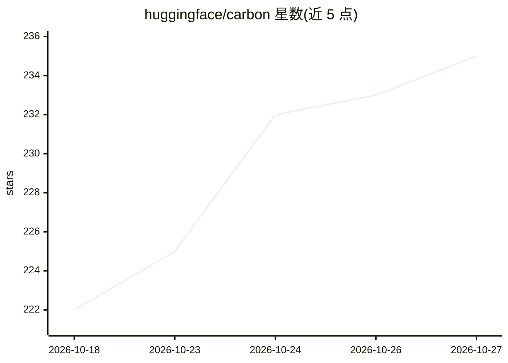

# huggingface/carbon

⭐ 235 · Python · Apache-2.0 · 推送 2026-10-26 · [GitHub](https://github.com/huggingface/carbon) · 组织维护

**Hugging Face 的 DNA 基因组基础模型及评测/微调代码库**

Carbon 是 Hugging Face 与中关村学院、那不勒斯大学等合作发布的基因组基础模型家族（500M/3B/8B），在 1T DNA token（约 6T 碱基对）上训练，采用 BPE+6-mer 混合分词器并以 <dna> 标签切换。仓库提供模型推理示例、七个零样本 DNA 评测（变异效应预测、序列恢复、扰动任务、Genome-NIAH 长上下文检索，支持 Carbon/GENERator/Evo2 三家后端对比）以及分类微调、FNS 微调与持续预训练脚本。许可 Apache 2.0。

## 筛选速览

| 维度 | 判定 | 备注 |
|---|---|---|
| AI 角色 | `ai-native` | 本体是模型或模型工具 |
| 许可风险 | `permissive` | Apache-2.0 |
| 部署形态 | `None` |  |
| 模型依赖 | — | README 未给出锁定关系 |
| 硬件要求 | — | 无带数字的原话,不猜 |
| 安装摩擦 | `low` | 无编译、无系统依赖或容器化 |
| 成熟度 | — | 结构信号不足 |

## 能力要点

- 500M/3B/8B 三个因果语言模型，训练于 1T DNA token
- 七个零样本 DNA 评测，单一后端标志跨 Carbon/GENERator/Evo2 运行
- 基于 transformers 的推理与零样本变异打分（读取全序列 log-likelihood）
- 微调配方：分类、FNS 因子化核苷酸监督、持续预训练

## 适用场景

- 我对 DNA 序列做零样本变异效应预测
- 我用统一评测套件比较基因组基础模型
- 我在下游任务上微调 Carbon 模型或对新物种持续预训练

## 场景标签

`模型评测` `微调` `科研工具` · 领域:评测与运维

## 证据(README 行号)

> L3: Genomic foundation models from Hugging Face. Carbon is a family of causal
> L4: language models trained on **1T tokens of DNA / 6T DNA base pairs** from the
> L92: This repo ships a **suite of seven zero-shot DNA evaluations** with

## 星数曲线

2026-10-18 222 → 2026-10-27 235（+13）

---
*卡片 v1 · prompt 1.4 · 生成 2026-10-22 · 置信度 high · 依据 README sha `3449af717a2e` · [字段定义](../../DATASET.md)*
