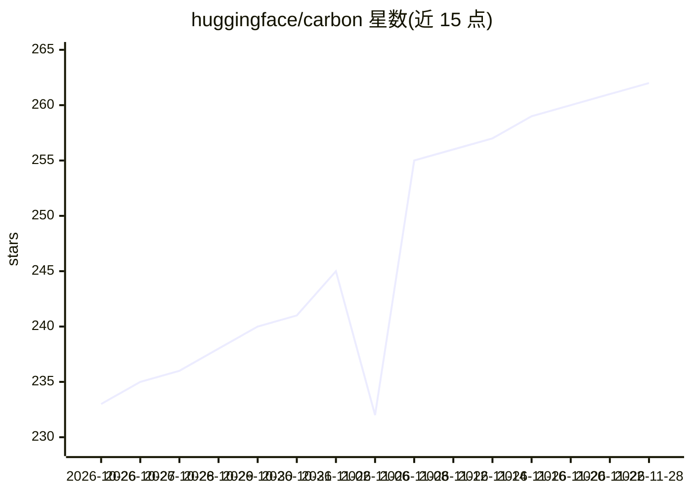

# huggingface/carbon

⭐ 262 · Python · Apache-2.0 · 推送 2026-11-01 · [GitHub](https://github.com/huggingface/carbon) · 组织维护 · 中文 README

**Hugging Face 的基因组基础模型及训练评测工具库**

Hugging Face 发布的基因组基础模型集合，包含 Carbon-500M/3B/8B 与 Carbon-X 等模型。每个模型发布放在独立目录中，自带依赖、训练配方与评测脚本；carbon/ 目录提供零样本 DNA 评测、微调配方与嵌入分析，carbon-x/ 目录提供 midtraining、SFT 与 RL 配方及 DNA 理解评测。使用 uv 同步依赖，在对应目录内运行命令。技术报告发布于 bioRxiv，采用 Apache 2.0 许可。

## 筛选速览

| 维度 | 判定 | 备注 |
|---|---|---|
| AI 角色 | `ai-native` | 本体是模型或模型工具 |
| 许可风险 | `permissive` | Apache-2.0 |
| 部署形态 | `None` |  |
| 模型依赖 | — | README 未给出锁定关系 |
| 硬件要求 | — | 无带数字的原话,不猜 |
| 安装摩擦 | `low` | 无编译、无系统依赖或容器化 |
| 成熟度 | — | 结构信号不足 |

## 能力要点

- 提供 Carbon-500M/3B/8B 与 Carbon-X 多个基因组基础模型
- 每个模型目录自带依赖、训练配方与评测脚本
- 覆盖零样本 DNA 评测、SFT/RL 训练与嵌入分析
- 技术报告发布于 bioRxiv

## 适用场景

- 对 DNA 序列做零样本评测与嵌入分析
- 按提供的配方对基因组模型进行微调或 SFT/RL 训练

## 场景标签

`模型评测` `微调` · 领域:评测与运维

## 证据(README 行号)

> L3: Genomic foundation models from Hugging Face.
> L10: |`carbon/`|Carbon-500M, Carbon-3B, Carbon-8B|Zero-shot DNA evals, finetuning recipes, embedding analysis|

## 星数曲线

2026-10-26 233 → 2026-11-28 262（+29）

---
*卡片 v1 · prompt 1.4 · 生成 2026-11-25 · 置信度 mid · 依据 README sha `823093372bd3` · [字段定义](../../DATASET.md)*
