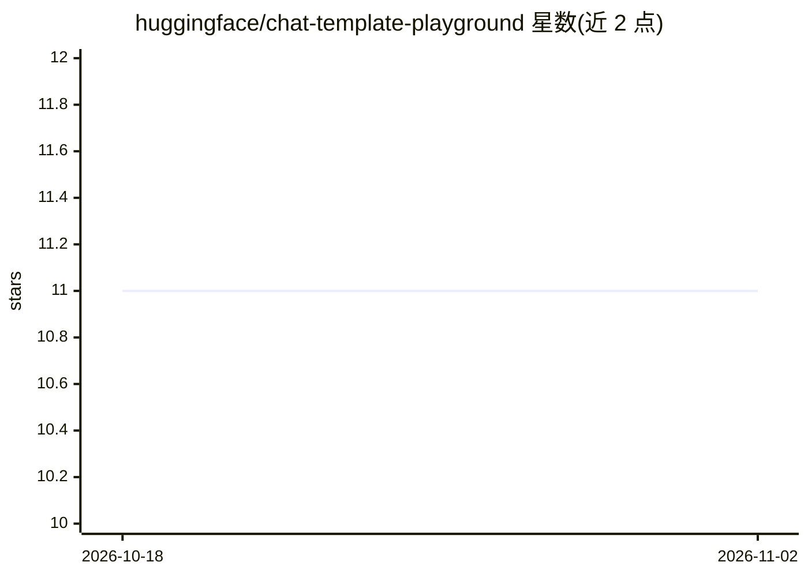

# huggingface/chat-template-playground

⭐ 11 · TypeScript · 推送 2026-09-23 · [GitHub](https://github.com/huggingface/chat-template-playground) · [官网](https://huggingface.co/spaces/huggingfacejs/chat-template-playground) · 组织维护

**试验聊天 UI 与聊天模板的 SvelteKit 在线 Playgroun**

基于 SvelteKit 的 Web 应用，用于试验、测试与调试聊天界面、聊天模板与交互组件。技术栈为 Bun、SvelteKit、Vite、sv 与 Tailwind CSS。提供 bun install 安装依赖、bun run dev 启动热重载开发服务器、bun run build 构建生产版本的工作流；README 提示部署到目标环境可能需安装 adapter。以 Docker 空间形式在 Hugging Face 上运行（app_port 3000）。

## 筛选速览

| 维度 | 判定 | 备注 |
|---|---|---|
| AI 角色 | `ai-ecosystem` | LLM/agent 周边工具 |
| 许可风险 | `permissive` | — |
| 部署形态 | `None` |  |
| 模型依赖 | — | README 未给出锁定关系 |
| 硬件要求 | — | 无带数字的原话,不猜 |
| 安装摩擦 | `low` | 无编译、无系统依赖或容器化 |
| 成熟度 | — | 结构信号不足 |

## 能力要点

- SvelteKit 实现的聊天 UI/模板试验场
- 支持本地开发（热重载）、生产构建与预览命令
- 技术栈：Bun / SvelteKit / Vite / sv / Tailwind CSS

## 适用场景

- 在浏览器中调试与试验聊天模板效果
- 为聊天组件开发提供本地迭代环境
- 在 Hugging Face Docker Space 中快速预览

## 场景标签

 · 领域:开发者工具/聊天界面

## 证据(README 行号)

> L12: A modern SvelteKit playground for experimenting with chat UIs, templates, and interactive components.
> L10: # Chat Template Playground

## 星数曲线

2026-10-18 11 → 2026-11-02 11（+0）

---
*卡片 v1 · prompt 1.4 · 生成 2026-11-02 · 置信度 mid · 依据 README sha `215f6b463872` · [字段定义](../../DATASET.md)*
