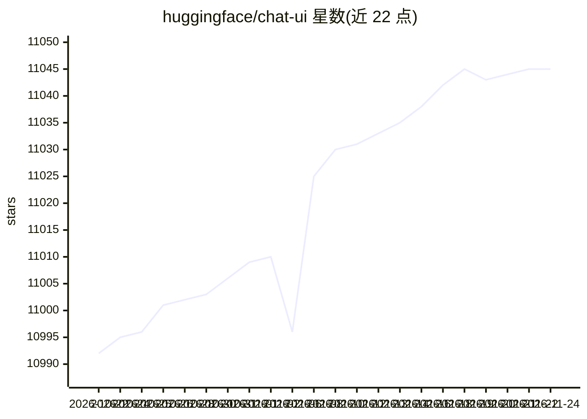

# huggingface/chat-ui

⭐ 11,045 · TypeScript · Apache-2.0 · 推送 2026-11-19 · [GitHub](https://github.com/huggingface/chat-ui) · [官网](https://huggingface.co/chat) · 组织维护

**面向 LLM 的开源聊天界面，驱动 HuggingChat**

基于 SvelteKit 的 LLM 聊天界面，是 hf.co/chat 上 HuggingChat 的源码。仅支持 OpenAI 兼容 API（通过 OPENAI_BASE_URL 与 /models 端点发现模型），任何说 OpenAI 协议的服务（llama.cpp server、Ollama、OpenRouter 等）默认可用；数据（历史、用户、设置、文件）存于 MongoDB，未配置时回退到内嵌 MongoDB。支持环境变量主题定制、可选的本地启发式 LLM 路由（Omni 别名，按多模态/工具/默认路由分发）、MCP 服务器工具调用，以及可在 Hugging Face Hub 上规划并运行 ML 任务的实验模式 ML Intern。

## 筛选速览

| 维度 | 判定 | 备注 |
|---|---|---|
| AI 角色 | `ai-ecosystem` | LLM/agent 周边工具 |
| 许可风险 | `permissive` | Apache-2.0 |
| 部署形态 | `self-host` | docker 或自建部署 |
| 模型依赖 | local-ok | 支持本地模型 |
| 硬件要求 | — | 无带数字的原话,不猜 |
| 安装摩擦 | `low` | 无编译、无系统依赖或容器化 |
| 成熟度 | — | 结构信号不足 |

## 能力要点

- 仅支持 OpenAI 兼容 API，模型经 /models 端点自动发现
- 可选 Omni 本地启发式路由：按图像输入/MCP 工具启用分流到 multimodal/agentic/default 路由
- 支持 MCP 服务器工具调用（OpenAI function calling）与每模型能力覆写
- 实验性 ML Intern 模式：在 Hugging Face Hub 上复现论文、微调、构建数据集并部署 Spaces

## 适用场景

- 自建一个对接任意 OpenAI 兼容端点的聊天界面
- 本地通过 llama.cpp server 或 Ollama 的 OpenAI 桥接运行私有聊天前端
- 配置 MCP 服务器让聊天中调用外部工具
- 部署面向团队或社区的 HuggingChat 类服务

## 场景标签

`聊天机器人` · 领域:对话与助手

## 证据(README 行号)

> L5: A chat interface for LLMs. It is a SvelteKit app and it powers the HuggingChat app on hf.co/chat.
> L16: > Chat UI only supports OpenAI-compatible APIs via `OPENAI_BASE_URL` and the `/models` endpoint. Provider-specific 

## 星数曲线

2026-10-22 10,992 → 2026-11-24 11,045（+53）

---
*卡片 v1 · prompt 1.4 · 生成 2026-11-22 · 置信度 high · 依据 README sha `a5363dcd527e` · [字段定义](../../DATASET.md)*
