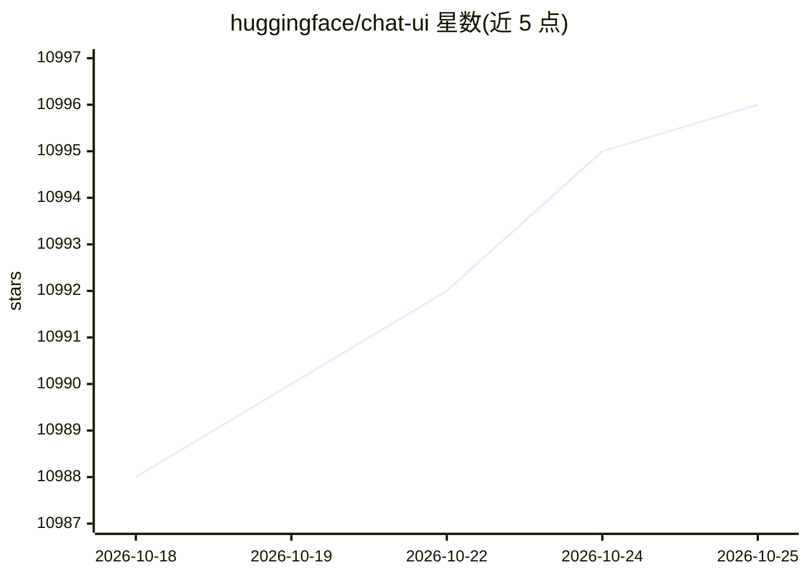

# huggingface/chat-ui

⭐ 11,001 · TypeScript · Apache-2.0 · 推送 2026-10-23 · [GitHub](https://github.com/huggingface/chat-ui) · [官网](https://huggingface.co/chat) · 组织维护

**驱动 HuggingChat 的开源 LLM 聊天界面（SvelteKit 应用）**

Hugging Face 维护的 SvelteKit 聊天应用，即 HuggingChat 的开源代码库。仅通过 OPENAI_BASE_URL 与 /models 端点接入 OpenAI 兼容 API（llama.cpp server、Ollama、OpenRouter 等均可），旧的按厂商集成（MODELS 专属通道、GGUF 发现等）已移除，旧版保留在 legacy 分支。聊天记录、用户等数据存于 MongoDB 6/7，未配置时回退到内嵌 MongoDB。支持可选的本地启发式 LLM 路由（Omni 别名）、MCP 工具调用，以及实验性的 ML Intern 模式。提供源码运行与捆绑 MongoDB 的 Docker 镜像。

## 筛选速览

| 维度 | 判定 | 备注 |
|---|---|---|
| AI 角色 | `ai-native` | 本体是模型或模型工具 |
| 许可风险 | `permissive` | Apache-2.0 |
| 部署形态 | `self-host` | docker 或自建部署 |
| 模型依赖 | local-ok | 支持本地模型 |
| 硬件要求 | — | 无带数字的原话,不猜 |
| 安装摩擦 | `low` | 无编译、无系统依赖或容器化 |
| 成熟度 | `idea` | |

## 能力要点

- 仅支持 OpenAI 兼容 API，模型从 /models 端点自动发现
- 基于本地启发式的 LLM 路由（Omni 虚拟模型，default/multimodal/agentic 三路）
- 可调用 MCP 服务器工具并通过 OpenAI function calling 回传结果
- ML Intern 实验模式：在 HF Hub 上复现论文、微调评估模型、部署 Spaces

## 适用场景

- 自建类似 HuggingChat 的 LLM 对话 Web 应用
- 对接本地 llama.cpp/Ollama 或 OpenRouter 等任意 OpenAI 兼容服务
- 在聊天中挂载 MCP 工具服务器并调用工具

## 场景标签

`聊天机器人` · 领域:对话与助手

## 证据(README 行号)

> L5: A chat interface for LLMs. It is a SvelteKit app and it powers the HuggingChat app on hf.co/chat.
> L23: Chat UI speaks to OpenAI-compatible APIs only. The fastest way to get running is with the Hugging Face Inference Pr
> L16: > Chat UI only supports OpenAI-compatible APIs via `OPENAI_BASE_URL` and the `/models` endpoint. Provider-specific 

## 星数曲线

2026-10-18 10,988 → 2026-10-25 10,996（+8）

---
*卡片 v1 · prompt 1.4 · 生成 2026-10-20 · 置信度 high · 依据 README sha `d4fd9435ccc8` · [字段定义](../../DATASET.md)*
