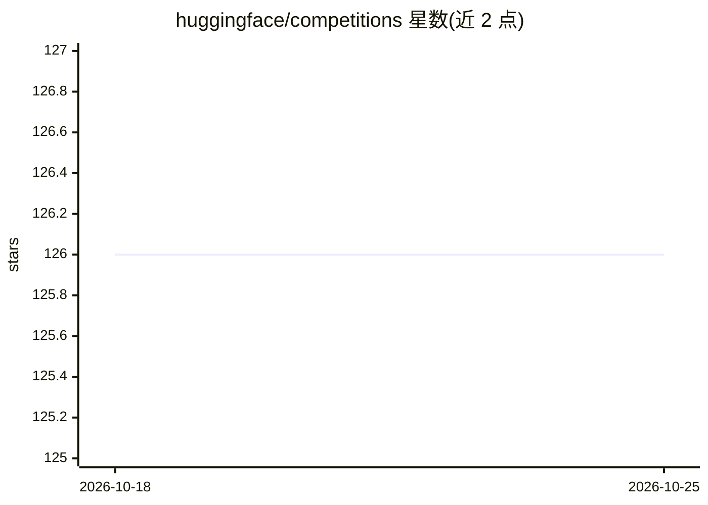

# huggingface/competitions

⭐ 126 · Python · Apache-2.0 · 推送 2026-10-14 · [GitHub](https://github.com/huggingface/competitions) · [官网](https://huggingface.co/docs/competitions) · 组织维护

**面向组织/公众创建机器学习竞赛的平台文档仓库**

Hugging Face 维护的竞赛服务说明仓库：介绍两种竞赛类型——generic（参赛者提交 CSV 预测文件，测试数据全程可见）与 script（参赛者提交生成预测的代码，可隐藏测试数据）。创建竞赛免费，但 script 竞赛需付费租用 CPU/GPU 实例（T4、A10G、A100，按小时计费）运行参赛代码；generic 竞赛可免费运行，可选购 cpu-basic 加速指标计算。竞赛可设公开或私有（仅受邀者可见）。README 未给出安装或部署命令，指引用户阅读文档创建竞赛。

## 筛选速览

| 维度 | 判定 | 备注 |
|---|---|---|
| AI 角色 | `ai-ecosystem` | LLM/agent 周边工具 |
| 许可风险 | `permissive` | Apache-2.0 |
| 部署形态 | `None` |  |
| 模型依赖 | — | README 未给出锁定关系 |
| 硬件要求 | — | 无带数字的原话,不猜 |
| 安装摩擦 | `low` | 无编译、无系统依赖或容器化 |
| 成熟度 | — | 结构信号不足 |

## 能力要点

- generic 与 script 两种竞赛类型，后者支持隐藏测试数据并运行参赛代码
- 可选 CPU/GPU 实例（T4/A10g/A100），按小时计费
- 竞赛可设为公开或私有（仅受邀参与）

## 适用场景

- 为组织或公开社区举办机器学习竞赛
- 举办需隐藏测试数据、运行参赛者代码的脚本类竞赛
- 在受控范围内举办私有邀请制竞赛

## 场景标签

`模型评测` · 领域:评测与运维

## 证据(README 行号)

> L3: Create a machine learning competition for your organization, friends or the world!
> L9: - generic: a competition where you provide the data and the participants provide the predictions as a CSV file. all 

## 星数曲线

2026-10-18 126 → 2026-10-25 126（+0）

---
*卡片 v1 · prompt 1.4 · 生成 2026-10-23 · 置信度 mid · 依据 README sha `aa814b28b0f7` · [字段定义](../../DATASET.md)*
