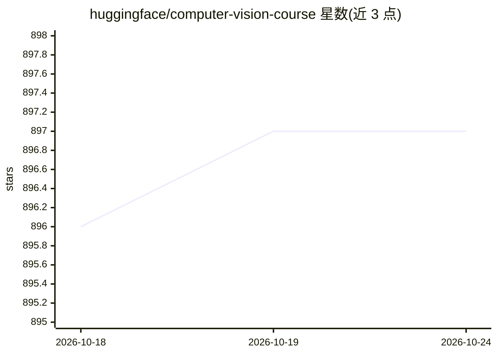

# huggingface/computer-vision-course

⭐ 897 · Jupyter Notebook · MIT · 推送 2026-10-06 · [GitHub](https://github.com/huggingface/computer-vision-course) · 组织维护

**社区共创的计算机视觉课程，覆盖 CNN 到视觉 Transformer**

由 Hugging Face 计算机视觉社区 60 余名贡献者共同编写的开源课程，内容涵盖基础知识、卷积神经网络、视觉 Transformer、多模态模型、生成模型、基础 CV 任务、视频处理、3D 视觉、模型优化、合成数据、零样本视觉及伦理偏见等 14 个章节。各作者保留自己的写作风格，社区成员负责评审。通过 GitHub 仓库与 Discord 社区（#cv-community-project 频道）提供内容与讨论渠道，接受贡献者提交内容或勘误。

## 筛选速览

| 维度 | 判定 | 备注 |
|---|---|---|
| AI 角色 | `ai-knowledge` | 知识聚合/清单类 |
| 许可风险 | `permissive` | MIT |
| 部署形态 | `None` |  |
| 模型依赖 | — | README 未给出锁定关系 |
| 硬件要求 | — | 无带数字的原话,不猜 |
| 安装摩擦 | `low` | 无编译、无系统依赖或容器化 |
| 成熟度 | — | 结构信号不足 |

## 能力要点

- 60 余名社区贡献者共同编写
- 课程含 14 个章节，从基础知识到伦理偏见与展望
- 经社区评审流程，接受内容贡献与勘误

## 适用场景

- 系统学习从 CNN 到视觉 Transformer 的计算机视觉知识
- 了解多模态、生成模型、零样本视觉等前沿主题
- 加入 HF 计算机视觉社区参与讨论或贡献内容

## 场景标签

`教程课程` · 领域:学习与行业

## 证据(README 行号)

> L3: # Community-led Computer Vision Community Course 🤗
> L5: This is the repository for a community-led course on Computer Vision. Over 60 contributors from the Hugging Face Com
> L9: 1. Fundamentals

## 星数曲线

2026-10-18 896 → 2026-10-24 897（+1）

---
*卡片 v1 · prompt 1.4 · 生成 2026-10-21 · 置信度 high · 依据 README sha `220481f921f9` · [字段定义](../../DATASET.md)*
