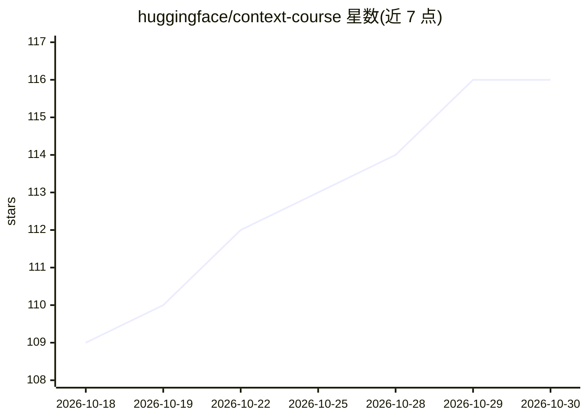

# huggingface/context-course

⭐ 116 · Python · 推送 2026-10-27 · [GitHub](https://github.com/huggingface/context-course) · 组织维护

**面向代码 agent 的上下文工程课程（技能/MCP/插件/子agent）**

Hugging Face 出品的免费课程，教授为代码 agent 做上下文工程的技能：编写可移植的 agent skills、构建 MCP 服务器、将技能与 MCP 服务器打包为插件、编排子 agent 完成多 agent 工作流、用 hooks 观察与拦截 agent 生命周期，并附赠从零构建最小 agent 的实战单元。示例贯穿 Claude Code、Codex、OpenCode 三个参考 agent；要求 Python 与命令行基础及 HF 账号，完成测验与项目可获证书。

## 筛选速览

| 维度 | 判定 | 备注 |
|---|---|---|
| AI 角色 | `ai-knowledge` | 知识聚合/清单类 |
| 许可风险 | `none` | — |
| 部署形态 | `None` |  |
| 模型依赖 | — | README 未给出锁定关系 |
| 硬件要求 | — | 无带数字的原话,不猜 |
| 安装摩擦 | `low` | 无编译、无系统依赖或容器化 |
| 成熟度 | — | 结构信号不足 |

## 能力要点

- 覆盖 skills/MCP/插件/子agent/hooks 完整上下文工程栈
- 以 Claude Code、Codex、OpenCode 三个参考 agent 端到端示例
- Unit 6 从零构建最小 agent（Nano Harness）
- 通过测验与实战项目提供两级认证

## 适用场景

- 系统学习如何为代码 agent 提供知识、工具与结构
- 掌握 MCP 服务器与 agent 插件打包分发
- 想构建自己的 agent 时参考 Nano Harness 单元

## 场景标签

`教程课程` · 领域:学习与行业

## 证据(README 行号)

> L5: The Context Course teaches you **context engineering for code agents** — the skill of giving agents the right knowle
> L7: The course covers the full context engineering stack: **skills, MCP, plugins, subagents**, and even building your ow
> L11: |Unit|Topic|Description|

## 星数曲线

2026-10-18 109 → 2026-10-30 116（+7）

---
*卡片 v1 · prompt 1.4 · 生成 2026-10-23 · 置信度 high · 依据 README sha `f8634239342f` · [字段定义](../../DATASET.md)*
