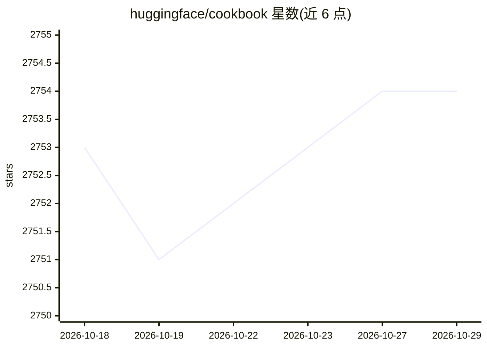

# huggingface/cookbook

⭐ 2,754 · Jupyter Notebook · Apache-2.0 · 推送 2026-10-28 · [GitHub](https://github.com/huggingface/cookbook) · [官网](https://huggingface.co/learn/cookbook) · 组织维护

**社区共建的开源 AI 实践教程集合（Jupyter notebook 配方）**

Hugging Face 组织维护的社区驱动开源 AI 食谱仓库：以 Jupyter notebook 形式收录构建 AI 应用、用开源工具与模型解决各类任务的端到端实用示例。README 主要说明贡献流程：通过 Issue 提想法、提交新 notebook、改进现有示例；并给出合格 notebook 的标准（实用、使用开源工具与模型、清晰可执行、内容中立无品牌倾向）及 PR 规范（文件命名、加入 _toctree.yml、署名等）。合并后的 notebook 会展示在 hf.co/learn/cookbook 页面。

## 筛选速览

| 维度 | 判定 | 备注 |
|---|---|---|
| AI 角色 | `ai-knowledge` | 知识聚合/清单类 |
| 许可风险 | `permissive` | Apache-2.0 |
| 部署形态 | `library` | 以包/库形式分发 |
| 模型依赖 | — | README 未给出锁定关系 |
| 硬件要求 | — | 无带数字的原话,不猜 |
| 安装摩擦 | `low` | 无编译、无系统依赖或容器化 |
| 成熟度 | — | 结构信号不足 |

## 能力要点

- 社区驱动的 AI 实用示例 notebook 集合
- 要求示例基于开源工具与宽许可的模型/数据集构建
- 明确的贡献流程与 notebook 质量标准（实用/清晰/可执行/内容中立）

## 适用场景

- 查找用开源模型解决具体 AI 任务的端到端示例
- 学习 RAG 等常见 AI 应用的实践做法
- 通过贡献 notebook 参与社区共建并获取徽章

## 场景标签

`教程课程` · 领域:学习与行业

## 证据(README 行号)

> L3: This repo contains community-driven practical examples of building AI applications and solving various tasks with AI
> L4: using open-source tools and models.

## 星数曲线

2026-10-18 2,753 → 2026-10-29 2,754（+1）

---
*卡片 v1 · prompt 1.4 · 生成 2026-10-21 · 置信度 mid · 依据 README sha `38889946baf8` · [字段定义](../../DATASET.md)*
