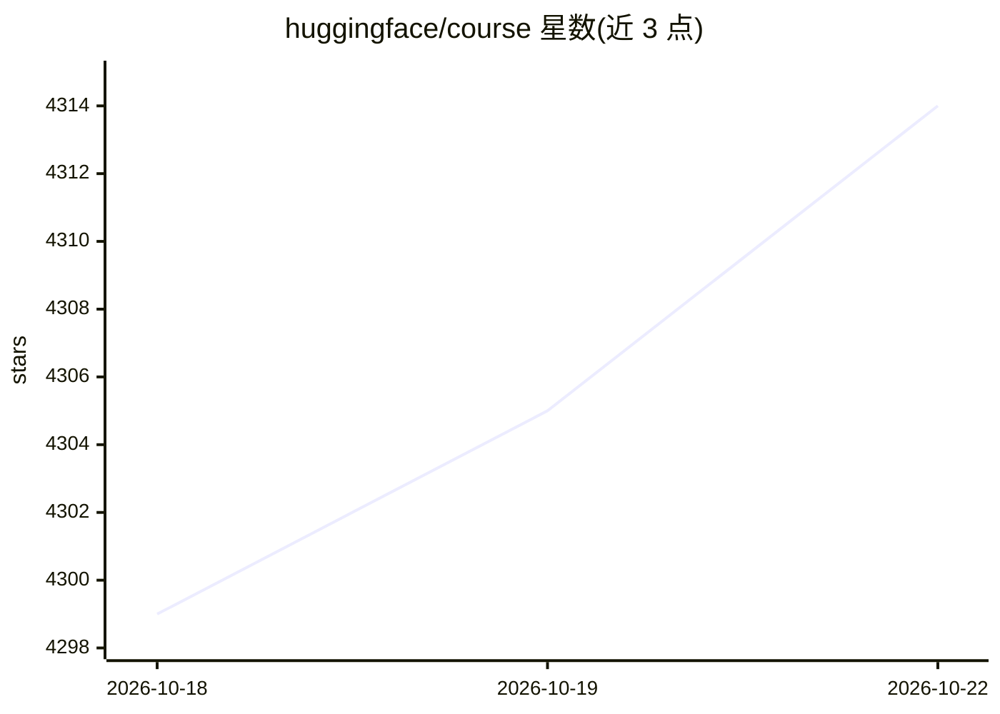

# huggingface/course

⭐ 4,316 · MDX · Apache-2.0 · 推送 2026-10-06 · [GitHub](https://github.com/huggingface/course) · [官网](https://huggingface.co/course) · 组织维护

**Hugging Face 官方 Transformers 免费课程的内容仓库**

存放 Hugging Face 官方课程全部内容（MDX 文章与代码片段）的开源仓库，课程教授如何将 Transformers 应用于 NLP 等任务，并使用 🤗 Transformers、Datasets、Tokenizers、Accelerate 与 Hub 等生态组件。内容按 20 余种语言目录组织，多数语言版本标注为翻译中（WIP）。README 主要面向贡献者：说明翻译流程（issue 认领、fork、复制章节、本地用 doc-builder 预览、PR 提交）、用脚本从章节生成 Jupyter notebook，以及 HF 员工的部署流程；目前不接受社区新增章节。课程本身免费且开源。

## 筛选速览

| 维度 | 判定 | 备注 |
|---|---|---|
| AI 角色 | `ai-knowledge` | 知识聚合/清单类 |
| 许可风险 | `permissive` | Apache-2.0 |
| 部署形态 | `library` | 以包/库形式分发 |
| 模型依赖 | — | README 未给出锁定关系 |
| 硬件要求 | — | 无带数字的原话,不猜 |
| 安装摩擦 | `low` | 无编译、无系统依赖或容器化 |
| 成熟度 | — | 结构信号不足 |

## 能力要点

- 课程内容覆盖 Transformers 在 NLP 等任务的应用与 HF 生态工具链
- 20 余种语言的翻译目录组织，含简体/繁体中文
- 提供脚本从章节代码片段生成 Jupyter notebooks
- 本地可用 doc-builder 预览构建内容

## 适用场景

- 系统学习 Transformers 与 Hugging Face 生态的使用
- 参与课程的多语言翻译贡献
- 本地生成并运行课程配套的 Jupyter notebooks

## 场景标签

`教程课程` · 领域:学习与行业

## 证据(README 行号)

> L3: This repo contains the content that's used to create the **Hugging Face course**. The course teaches you about apply
> L131: ## 📔 Jupyter notebooks

## 星数曲线

2026-10-18 4,299 → 2026-10-22 4,314（+15）

---
*卡片 v1 · prompt 1.4 · 生成 2026-10-20 · 置信度 high · 依据 README sha `4048804952c0` · [字段定义](../../DATASET.md)*
