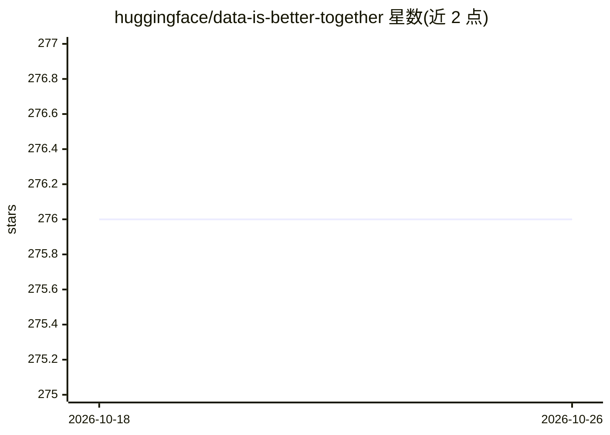

# huggingface/data-is-better-together

⭐ 276 · Jupyter Notebook · 推送 2026-10-24 · [GitHub](https://github.com/huggingface/data-is-better-together) · 组织维护

**社区共建数据集协作计划：共同构建高质量数据集与指南**

由 Hugging Face、Argilla 与开源 ML 社区合作发起的数据集共建计划，包含社区项目与 Cookbook 两部分。社区项目已完成：10k 提示质量排序（385 人参与，发布 10k_prompts_ranked）、MPEP 多语言提示翻译评测（荷兰语/俄语完成）、10K 文生图偏好对标注。Cookbook 部分提供领域数据集、DPO/ORPO、KTO 偏好数据集等构建指南与工具，社区可自由参与贡献。

## 筛选速览

| 维度 | 判定 | 备注 |
|---|---|---|
| AI 角色 | `ai-knowledge` | 知识聚合/清单类 |
| 许可风险 | `none` | — |
| 部署形态 | `None` |  |
| 模型依赖 | — | README 未给出锁定关系 |
| 硬件要求 | — | 无带数字的原话,不猜 |
| 安装摩擦 | `low` | 无编译、无系统依赖或容器化 |
| 成熟度 | — | 结构信号不足 |

## 能力要点

- 10k 提示质量排序数据集，385 人参与标注
- MPEP 多语言提示翻译，覆盖荷兰语、俄语等语言
- 10K 文生图偏好对，用于评估图像生成模型
- DPO/ORPO 与 KTO 偏好数据集构建指南与工具

## 适用场景

- 获取已发布的高质量提示与偏好数据集用于训练或评测
- 为缺少 DPO/KTO 数据集的语言构建偏好数据
- 按 Cookbook 指南与领域专家协作构建领域数据集

## 场景标签

`教程课程` · 领域:学习与行业

## 证据(README 行号)

> L7: Data is Better Together is a collaboration between 🤗 Hugging Face, 🏓 Argilla, and the Open-Source ML community. We a
> L9:  Community Efforts : They were guided by the HF Team, hands-on projects focused on creating valuable datasets. These
> L29:  Cookbook Efforts : They aim to create guides and tools that help the community in building valuable datasets. They

## 星数曲线

2026-10-18 276 → 2026-10-26 276（+0）

---
*卡片 v1 · prompt 1.4 · 生成 2026-10-22 · 置信度 high · 依据 README sha `20e00637d288` · [字段定义](../../DATASET.md)*
