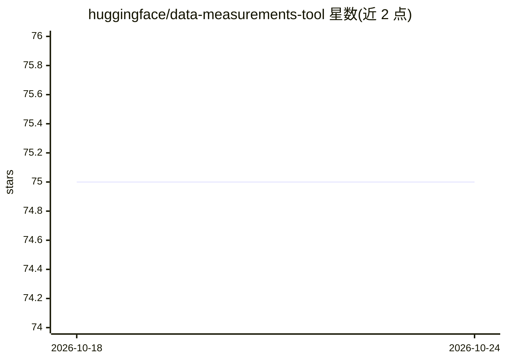

# huggingface/data-measurements-tool

⭐ 75 · Python · Apache-2.0 · 推送 2026-09-23 · [GitHub](https://github.com/huggingface/data-measurements-tool) · 组织维护

**分析 Hugging Face 数据集各项指标的测量工具**

Hugging Face 维护的数据集分析工具：通过命令行脚本 run_data_measurements.py 或 Streamlit 界面，对指定的 HF Dataset（数据集、配置、split、列）执行测量计算（如 nPMI 等可选项），支持缓存与保存配置。面向需要在训练前检视数据集特征的开发者与研究者。README 标注处于开发建设中，安装方式为 clone 后 pip install -r requirements.txt。

## 筛选速览

| 维度 | 判定 | 备注 |
|---|---|---|
| AI 角色 | `ai-ecosystem` | LLM/agent 周边工具 |
| 许可风险 | `permissive` | Apache-2.0 |
| 部署形态 | `library` | 以包/库形式分发 |
| 模型依赖 | — | README 未给出锁定关系 |
| 硬件要求 | — | 无带数字的原话,不猜 |
| 安装摩擦 | `low` | 无编译、无系统依赖或容器化 |
| 成熟度 | `idea` | |

## 能力要点

- 命令行指定数据集/配置/split/列进行测量
- 可单独运行指定测量项（如 nPMI）
- 提供 Streamlit 用户界面（app.py）

## 适用场景

- 训练前分析数据集的统计特征
- 检查仇恨言论等文本数据集的词共现指标
- 通过界面浏览数据集测量结果

## 场景标签

`MLOps` · 领域:训练与推理

## 证据(README 行号)

> L29: From there, you can measure different aspects of different datasets by running `run_data_measurements.py` with diff
> L39: python3 run_data_measurements.py --dataset="hate_speech18" --config="default" --split="train" --feature="text"

## 星数曲线

2026-10-18 75 → 2026-10-24 75（+0）

---
*卡片 v1 · prompt 1.4 · 生成 2026-10-24 · 置信度 mid · 依据 README sha `75c0dcf9f0e6` · [字段定义](../../DATASET.md)*
