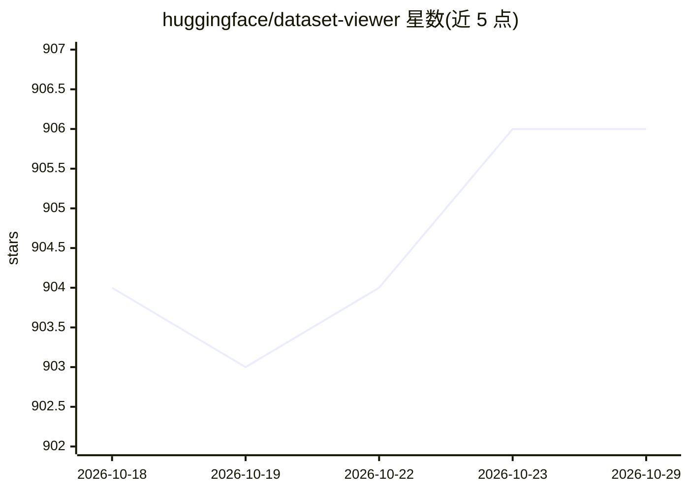

# huggingface/dataset-viewer

⭐ 906 · Python · Apache-2.0 · 推送 2026-10-28 · [GitHub](https://github.com/huggingface/dataset-viewer) · [官网](https://huggingface.co/docs/dataset-viewer) · 组织维护

**支撑 Hugging Face 数据集页面的数据集查看器后端 API**

为 Hugging Face Hub 上全部数据集的查看器组件提供预计算数据的 REST API 后端：支持分页浏览（每页 100 行）、过滤、搜索与基础统计等能力。前端查看器组件不开源、不在本仓库内。README 仅作简介与指引：通过文档链接说明查看器用法、数据集配置与后端 API，开发安装细节位于 DEVELOPER_GUIDE.md，贡献流程见 CONTRIBUTING.md。由 Hugging Face 团队维护，面向平台开发与贡献者。

## 筛选速览

| 维度 | 判定 | 备注 |
|---|---|---|
| AI 角色 | `ai-ecosystem` | LLM/agent 周边工具 |
| 许可风险 | `permissive` | Apache-2.0 |
| 部署形态 | `None` |  |
| 模型依赖 | — | README 未给出锁定关系 |
| 硬件要求 | — | 无带数字的原话,不猜 |
| 安装摩擦 | `low` | 无编译、无系统依赖或容器化 |
| 成熟度 | — | 结构信号不足 |

## 能力要点

- 为 Hub 全部数据集提供预计算数据的公共 API
- 支持分页、过滤、搜索与基础统计的数据查看能力
- 提供数据集查看器、数据配置与后端 API 三份文档链接

## 适用场景

- 通过公共 API 获取 Hugging Face 数据集的分页内容
- 为数据集查看器修复错误或提交功能贡献
- 排查数据集页面显示错误并反馈给团队

## 场景标签

 · 领域:机器学习/数据基础设施

## 证据(README 行号)

> L7: This repository is the backend that provides the dataset viewer with pre-computed data through an API, for all the d
> L12: - backend's API: https://huggingface.co/docs/dataset-viewer

## 星数曲线

2026-10-18 904 → 2026-10-29 906（+2）

---
*卡片 v1 · prompt 1.4 · 生成 2026-10-21 · 置信度 high · 依据 README sha `ff8fc62ea058` · [字段定义](../../DATASET.md)*
