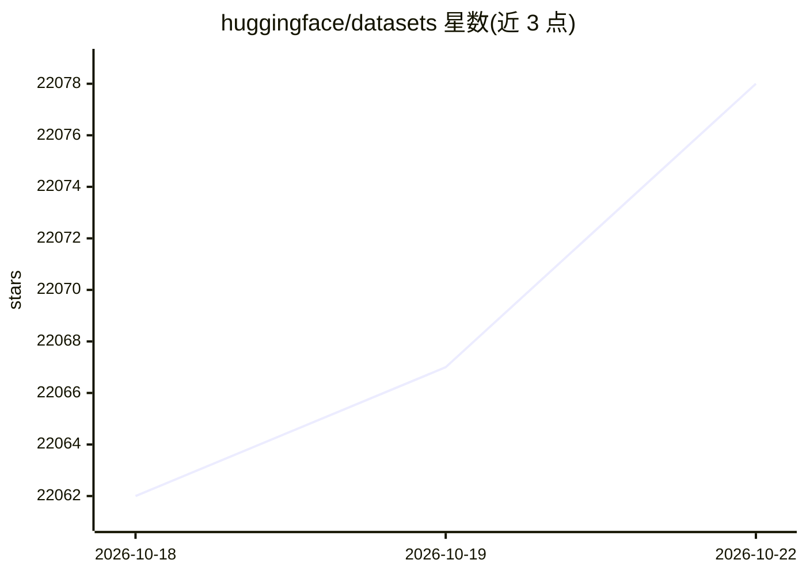

# huggingface/datasets

⭐ 22,078 · Python · Apache-2.0 · 推送 2026-10-22 · [GitHub](https://github.com/huggingface/datasets) · [官网](https://huggingface.co/docs/datasets) · 组织维护

**ML 从业者的一站式数据集加载与预处理库**

Hugging Face 的 Python 数据集库：通过 load_dataset() 一行命令加载 Hub 上图像、音频、文本（467 种语言）、视频、PDF、NIfTI 等公开数据集，也可读取本地 CSV/JSON/Parquet 等文件或 Python 对象。基于 Apache Arrow 后端做零拷贝内存映射与智能缓存，支持 streaming=True 流式迭代、map() 多进程预处理，并可转换为 NumPy/Pandas/PyTorch/TensorFlow/JAX/Spark 等框架格式。面向训练与评估 ML 模型的开发者与科研人员。

## 筛选速览

| 维度 | 判定 | 备注 |
|---|---|---|
| AI 角色 | `ai-ecosystem` | LLM/agent 周边工具 |
| 许可风险 | `permissive` | Apache-2.0 |
| 部署形态 | `library` | 以包/库形式分发 |
| 模型依赖 | — | README 未给出锁定关系 |
| 硬件要求 | — | 无带数字的原话,不猜 |
| 安装摩擦 | `low` | 无编译、无系统依赖或容器化 |
| 成熟度 | — | 结构信号不足 |

## 动量与使用信号

- 维护:`active` — 距上次 push 1.8 天,年发版 17,445 位贡献者
- 涨星:近 1 天 **+2**(自 20261016 起算)
- 安装:pypi 包 `datasets` 月下载 66,840,074

## 能力要点

- load_dataset() 一行加载 Hub 公开数据集与本地文件
- Apache Arrow 零拷贝内存映射，支持 streaming 流式迭代
- 多框架互转：NumPy/Pandas/Polars/PyTorch/TensorFlow/JAX/Spark
- 内置 FAISS 与 Elasticsearch 相似性检索索引支持

## 适用场景

- 为模型训练/评估快速加载公开数据集
- 磁盘装不下的大规模数据集用 streaming 方式迭代
- 对本地 CSV/JSON/Parquet 数据做可复现预处理
- 加载和处理 agent traces 数据

## 场景标签

 · 领域:机器学习/数据工具

## 证据(README 行号)

> L11: 🤗 Datasets is a lightweight library providing **two** main features:
> L13: - **one-line dataloaders for many public datasets**: one-liners to download and pre-process any of the number of da
> L24: |📦 **One-line dataset loading**|Load AI-ready datasets from the Hugging Face Hub or local files with `load_dataset(

## 星数曲线

2026-10-18 22,062 → 2026-10-22 22,078（+16）

---
*卡片 v1 · prompt 1.4 · 生成 2026-10-18 · 置信度 high · 依据 README sha `756bba187ea0` · [字段定义](../../DATASET.md)*
