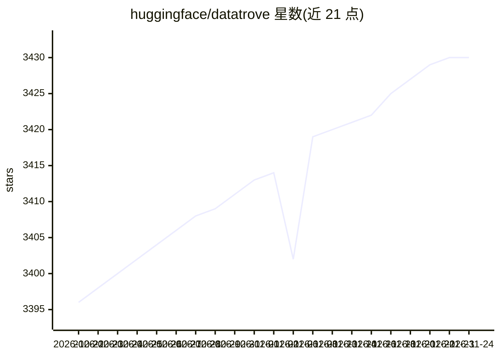

# huggingface/datatrove

⭐ 3,430 · Python · Apache-2.0 · 推送 2026-11-18 · [GitHub](https://github.com/huggingface/datatrove) · 组织维护

**面向 LLM 训练数据的大规模文本处理/过滤/去重流水线库**

DataTrove 是一个用于大规模处理、过滤和去重文本数据的 Python 库，提供预置的处理块（readers/writers/extractors/filters/stats/tokens/dedup）并可自定义扩展。流水线与执行平台解耦：同一 pipeline 可无改动运行在本地多进程、Slurm 集群或 Ray 集群上，通过 task/shard 切分并行，并记录已完成任务以便失败后断点重跑。文件系统访问基于 fsspec，支持本地、远程及 S3。安装需 Python 3.11+，依赖按 extra 分组可选（io/processing/s3/cli/ray/inference/decont 等）。

## 筛选速览

| 维度 | 判定 | 备注 |
|---|---|---|
| AI 角色 | `ai-ecosystem` | LLM/agent 周边工具 |
| 许可风险 | `permissive` | Apache-2.0 |
| 部署形态 | `None` |  |
| 模型依赖 | local-ok | 支持本地模型 |
| 硬件要求 | — | 无带数字的原话,不猜 |
| 安装摩擦 | `low` | 无编译、无系统依赖或容器化 |
| 成熟度 | — | 结构信号不足 |

## 能力要点

- 平台无关流水线：本地、Slurm、Ray 三种执行器运行同一 pipeline
- 任务完成标记支持失败重跑时跳过已完成任务
- 提供 FineWeb 复现、minhash 去重、token 量估算等示例
- 基于 fsspec 支持本地/远程/S3 等文件系统

## 适用场景

- 处理 CommonCrawl WARC 抓取数据以构建 LLM 训练语料
- 对大规模文本数据集做 minhash 去重
- 在 Slurm 集群上并行执行数据过滤与 token 化
- 构建数百 B token 规模的数据子集与混合配比

## 场景标签

`MLOps` · 领域:训练与推理

## 证据(README 行号)

> L3: DataTrove is a library to process, filter and deduplicate text data at a very large scale. It provides a set of preb
> L5: DataTrove processing pipelines are platform-agnostic, running out of the box locally or on a slurm cluster. Its (rel

## 星数曲线

2026-10-22 3,396 → 2026-11-24 3,430（+34）

---
*卡片 v1 · prompt 1.4 · 生成 2026-11-23 · 置信度 high · 依据 README sha `b67809d2fc29` · [字段定义](../../DATASET.md)*
