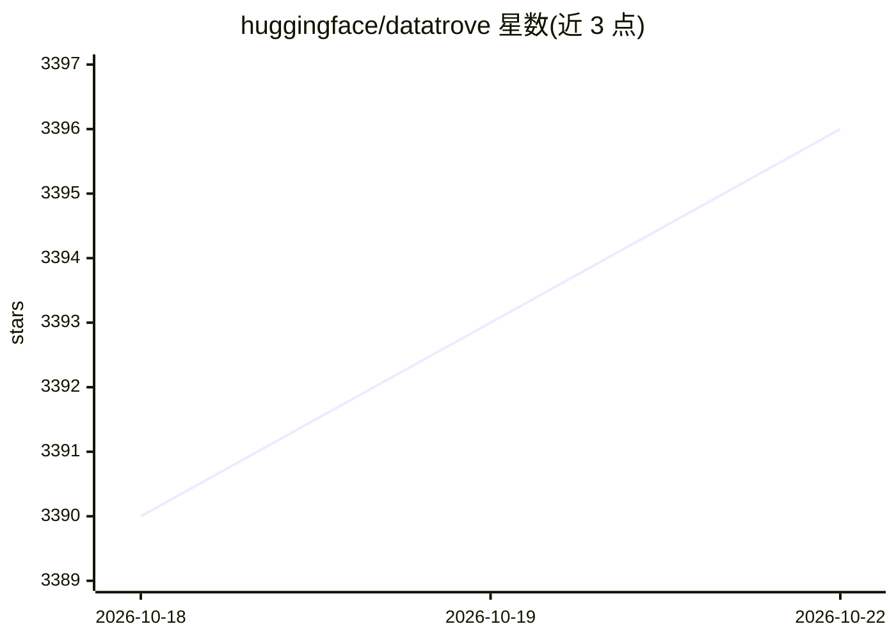

# huggingface/datatrove

⭐ 3,398 · Python · Apache-2.0 · 推送 2026-10-06 · [GitHub](https://github.com/huggingface/datatrove) · 组织维护

**大规模文本数据处理、过滤与去重的流水线库，面向 LLM 训练数据制备**

Hugging Face 维护的数据处理库：提供读取、提取、过滤、统计、分词、去重等预构建流水线块，以 Document 生成器串联；同一流水线可在本地多进程、Slurm、Ray 等执行环境运行，通过 task/shard 机制并行并记录已完成任务以支持断点续跑。文件系统经 fsspec 支持本地与远程（含 S3）。面向需要大规模处理 LLM 训练数据（如 FineWeb、C4 复现）的开发者与科研人员，需 Python 3.10+，附带多个完整示例脚本。

## 筛选速览

| 维度 | 判定 | 备注 |
|---|---|---|
| AI 角色 | `ai-ecosystem` | LLM/agent 周边工具 |
| 许可风险 | `permissive` | Apache-2.0 |
| 部署形态 | `None` |  |
| 模型依赖 | local-ok | 支持本地模型 |
| 硬件要求 | — | 无带数字的原话,不猜 |
| 安装摩擦 | `low` | 无编译、无系统依赖或容器化 |
| 成熟度 | — | 结构信号不足 |

## 能力要点

- 预构建流水线块：readers/writers/extractors/filters/stats/tokens/dedup 七类
- 平台无关执行器：本地多进程、Slurm 集群、Ray 集群，支持多节点分片
- 任务完成标记与断点续跑机制（skip_completed）
- minhash/句子级精确/精确子串等多种去重流水线示例

## 适用场景

- 复现 FineWeb、处理 Common Crawl 等大规模语料
- 为 LLM 训练做文本提取、过滤与去重
- 在 Slurm 或 Ray 集群上并行执行数据处理作业
- 估算与分词大型 HF 数据集（如 gpt2 tokenizer）

## 场景标签

`MLOps` · 领域:训练与推理

## 证据(README 行号)

> L3: DataTrove is a library to process, filter and deduplicate text data at a very large scale. It provides a set of preb
> L5: DataTrove processing pipelines are platform-agnostic, running out of the box locally or on a slurm cluster. Its (rel

## 星数曲线

2026-10-18 3,390 → 2026-10-22 3,396（+6）

---
*卡片 v1 · prompt 1.4 · 生成 2026-10-20 · 置信度 high · 依据 README sha `55295cdfd6d5` · [字段定义](../../DATASET.md)*
