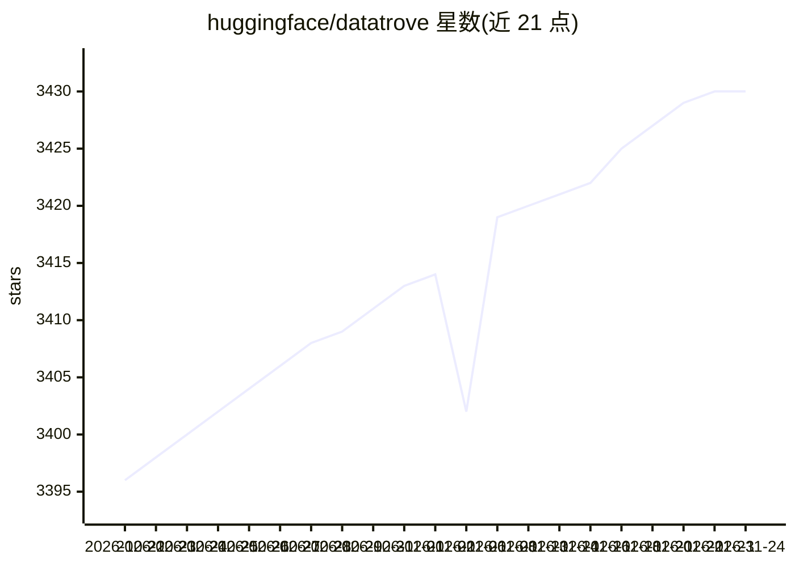

# huggingface/datatrove

⭐ 3,431 · Python · Apache-2.0 · 推送 2026-11-24 · [GitHub](https://github.com/huggingface/datatrove) · 组织维护

**面向 LLM 训练数据的大规模文本处理管道库**

DataTrove 是一个处理、过滤和去重大规模文本数据的 Python 库，提供预构建的处理块（readers/writers/extractors/filters/stats/tokens/dedup）并支持自定义扩展。管道与执行平台解耦，同一管道可无缝运行于本地机器、Slurm 集群或 Ray 集群；执行器以 task/shard 粒度并行，记录已完成任务，失败重跑时仅执行未完成任务。内存占用相对较低，主要面向 LLM 训练数据处理等工作负载。安装要求 Python 3.11+，通过 uv sync 配合 extras（io/processing/s3/ray/inference 等）安装依赖。

## 筛选速览

| 维度 | 判定 | 备注 |
|---|---|---|
| AI 角色 | `ai-ecosystem` | LLM/agent 周边工具 |
| 许可风险 | `permissive` | Apache-2.0 |
| 部署形态 | `None` |  |
| 模型依赖 | — | README 未给出锁定关系 |
| 硬件要求 | — | 无带数字的原话,不猜 |
| 安装摩擦 | `low` | 无编译、无系统依赖或容器化 |
| 成熟度 | — | 结构信号不足 |

## 能力要点

- 平台无关管道：本地、Slurm、Ray 三类执行器运行同一 pipeline
- 预构建处理块覆盖读取、抽取、过滤、统计、分词与去重
- 任务完成标记机制，失败后重跑自动跳过已完成 task
- 通过 fsspec 支持本地、远程及其他文件系统

## 适用场景

- 清洗和过滤 CommonCrawl 等 WARC 数据以构建 LLM 训练集
- 对大规模文本数据集做 minhash/精确子串去重
- 在 Slurm 集群上并行处理数万文件的数据管道
- 为 Hugging Face 数据集做 token 估算与子集混合配比

## 场景标签

`MLOps` · 领域:训练与推理

## 证据(README 行号)

> L3: DataTrove is a library to process, filter and deduplicate text data at a very large scale. It provides a set of preb
> L5: DataTrove processing pipelines are platform-agnostic, running out of the box locally or on a slurm cluster. Its (rel

## 星数曲线

2026-10-22 3,396 → 2026-11-24 3,430（+34）

---
*卡片 v1 · prompt 1.4 · 生成 2026-11-24 · 置信度 high · 依据 README sha `d343a09ea998` · [字段定义](../../DATASET.md)*
