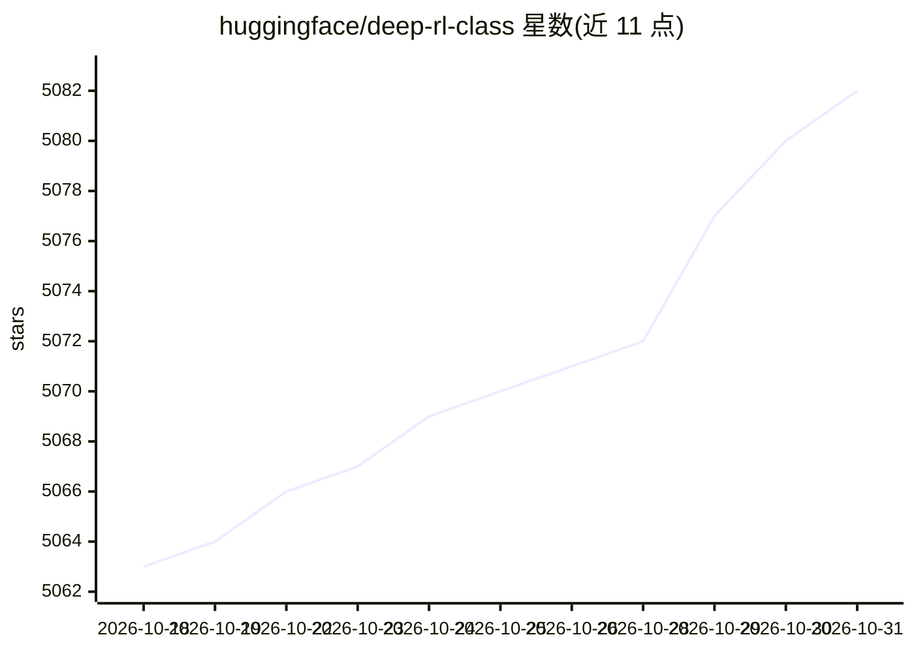

# huggingface/deep-rl-class

⭐ 5,082 · MDX · Apache-2.0 · 推送 2026-10-14 · [GitHub](https://github.com/huggingface/deep-rl-class) · 组织维护

**Hugging Face 深度强化学习课程（讲义与实战 Notebook）**

Hugging Face 维护的深度强化学习课程仓库，存放课程的 mdx 讲义文件与配套 Notebook，内容覆盖强化学习理论与实践练习，配套在线课程网站与教学大纲，提供邮件订阅入口。README 声明课程目前处于低维护状态：Unit 7（AI vs AI）功能不可用、排行榜已停止运营，其余理论内容与实践练习仍可访问。署名作者为 Thomas Simonini 与 Omar Sanseviero，并给出引用用的 bibtex 条目。

## 筛选速览

| 维度 | 判定 | 备注 |
|---|---|---|
| AI 角色 | `ai-knowledge` | 知识聚合/清单类 |
| 许可风险 | `permissive` | Apache-2.0 |
| 部署形态 | `None` |  |
| 模型依赖 | — | README 未给出锁定关系 |
| 硬件要求 | — | 无带数字的原话,不猜 |
| 安装摩擦 | `low` | 无编译、无系统依赖或容器化 |
| 成熟度 | — | 结构信号不足 |

## 能力要点

- 课程 mdx 讲义与实战 Notebook 文件集合
- 配套在线课程网站与教学大纲
- 提供 bibtex 引用条目与邮件订阅入口

## 适用场景

- 系统学习深度强化学习的理论与实战
- 获取可在本地运行的课程练习 Notebook
- 查找 RL 课程的引用信息

## 场景标签

`教程课程` · 领域:学习与行业

## 证据(README 行号)

> L7: This repository contains the Deep Reinforcement Learning Course mdx files and notebooks. **The website is here**: ht
> L17: Please note that this **Deep Reinforcement Learning course is now in a low-maintenance state**. However, it **remai

## 星数曲线

2026-10-18 5,063 → 2026-10-31 5,082（+19）

---
*卡片 v1 · prompt 1.4 · 生成 2026-10-20 · 置信度 high · 依据 README sha `133200e86122` · [字段定义](../../DATASET.md)*
