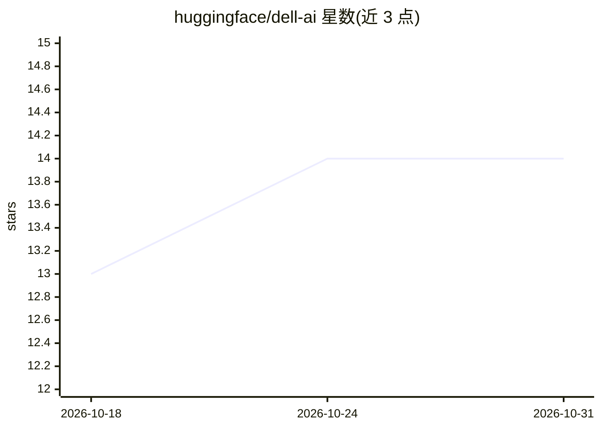

# huggingface/dell-ai

⭐ 14 · Python · Apache-2.0 · 推送 2026-09-21 · [GitHub](https://github.com/huggingface/dell-ai) · [官网](https://dell.huggingface.co/) · 组织维护

**Dell Enterprise Hub 的 Python SDK 与 CLI：浏览、部署和管理 Dell 硬件上的 AI 模型**

Hugging Face 维护的 Dell Enterprise Hub（DEH）官方 Python SDK 与 CLI：以编程方式浏览可用 AI 模型与应用、查看平台配置、生成部署代码片段，或直接在本机执行部署。部署引擎支持 Docker、Kubernetes（kubectl）与 Helm；自动管理主机端口与 GPU 索引，成功部署记录到部署注册表（本地/全局两级）以便后续查看、探活与卸载。另提供 goodput 场景驱动的最优配置选择（与手动指定 GPU 数互斥）、环境变量管理与 dell-ai status 状态检查。通过 uv 或 pip 安装，亦支持源码安装。

## 筛选速览

| 维度 | 判定 | 备注 |
|---|---|---|
| AI 角色 | `ai-ecosystem` | LLM/agent 周边工具 |
| 许可风险 | `permissive` | Apache-2.0 |
| 部署形态 | `library` | 以包/库形式分发 |
| 模型依赖 | — | README 未给出锁定关系 |
| 硬件要求 | — | 无带数字的原话,不猜 |
| 安装摩擦 | `low` | 无编译、无系统依赖或容器化 |
| 成熟度 | — | 结构信号不足 |

## 能力要点

- 浏览 DEH 模型/应用并生成部署代码片段
- 直接在本地节点部署，支持 Docker/Kubernetes/Helm 引擎
- 自动主机端口重映射与空闲 GPU 索引分配
- 部署注册表记录 endpoint/容器 ID/GPU，支持自动发现与清理

## 适用场景

- 在 Dell 服务器上部署 DEH 模型并跟踪其运行状态
- 按 goodput 场景让服务端选择最优 GPU 配置
- 统一管理本地部署的 endpoint、检查点与环境变量

## 场景标签

`推理引擎` · 领域:训练与推理

## 证据(README 行号)

> L7: A Python SDK and CLI for interacting with the Dell Enterprise Hub (DEH), allowing users to programmatically browse a
> L84: In addition to generating snippets, `dell-ai` can execute them directly on the

## 星数曲线

2026-10-18 13 → 2026-10-31 14（+1）

---
*卡片 v1 · prompt 1.4 · 生成 2026-10-31 · 置信度 high · 依据 README sha `39513e429db2` · [字段定义](../../DATASET.md)*
