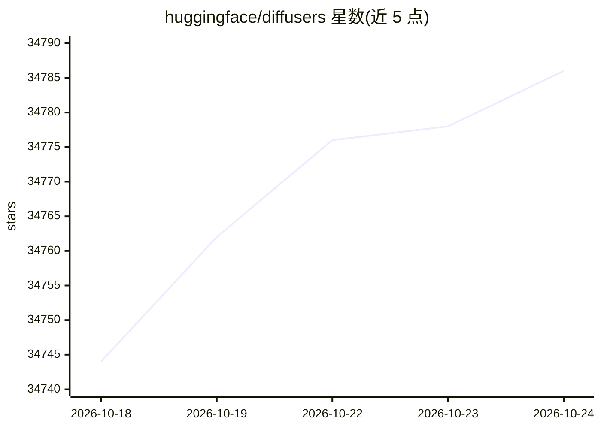

# huggingface/diffusers

⭐ 34,792 · Python · Apache-2.0 · 推送 2026-10-24 · [GitHub](https://github.com/huggingface/diffusers) · [官网](https://huggingface.co/docs/diffusers) · 组织维护

**为开发者提供 PyTorch 扩散模型的推理与训练工具库**

Hugging Face 维护的 PyTorch 扩散模型库，覆盖图像、音频与分子 3D 结构的生成任务。核心由三部分组成：数行代码即可运行的推理 pipeline、可互换的噪声调度器、可组合搭建自定义系统的预训练模型模块。README 提供 pip/conda 安装方式、文本生成图像的快速上手示例，并列出文本生成图像、图生图、修复、超分辨率等任务对应的 pipeline 与 Hub 上的 30,000+ 检查点入口。设计取向为可用性与可定制性，并提示贡献者参考 .ai/ 目录的 AI agent 约定。

## 筛选速览

| 维度 | 判定 | 备注 |
|---|---|---|
| AI 角色 | `ai-native` | 本体是模型或模型工具 |
| 许可风险 | `permissive` | Apache-2.0 |
| 部署形态 | `library` | 以包/库形式分发 |
| 模型依赖 | — | README 未给出锁定关系 |
| 硬件要求 | — | 无带数字的原话,不猜 |
| 安装摩擦 | `medium` | 含编译或系统依赖之一 |
| 成熟度 | — | 结构信号不足 |

## 动量与使用信号

- 维护:`active` — 距上次 push 1.3 天,年发版 7,457 位贡献者
- 涨星:近 1 天 **+15**(自 20261016 起算)
- 安装:pypi 包 `diffusers` 月下载 4,970,946

## 能力要点

- 提供数行代码完成推理的 diffusion pipeline 与 30,000+ 预训练检查点加载
- 噪声调度器可互换，预训练模型可作为组件组合搭建自定义扩散系统
- 覆盖文本生成图像、图生图、修复、超分辨率等任务及对应 pipeline 清单
- 提供面向 AI agent 的贡献约定（.ai/ 目录、claude plugin 安装）

## 适用场景

- 用几行代码加载预训练扩散模型生成图像
- 训练自己的扩散模型或搭建自定义端到端生成系统
- 按任务查找 Stable Diffusion、ControlNet、DDPM 等模型与 pipeline

## 场景标签

`图像生成` `视频生成` `模型训练` · 领域:内容生成

## 证据(README 行号)

> L7: 🤗 Diffusers is the go-to library for state-of-the-art pretrained diffusion models for generating images, audio, and 
> L11: - State-of-the-art diffusion pipelines that can be run in inference with just a few lines of code.
> L74: If you are using an AI agent, please point it at the project conventions in `.ai/` first (install them as a plugin 

## 星数曲线

2026-10-18 34,744 → 2026-10-24 34,786（+42）

---
*卡片 v1 · prompt 1.4 · 生成 2026-10-18 · 置信度 high · 依据 README sha `45d7760fb734` · [字段定义](../../DATASET.md)*
