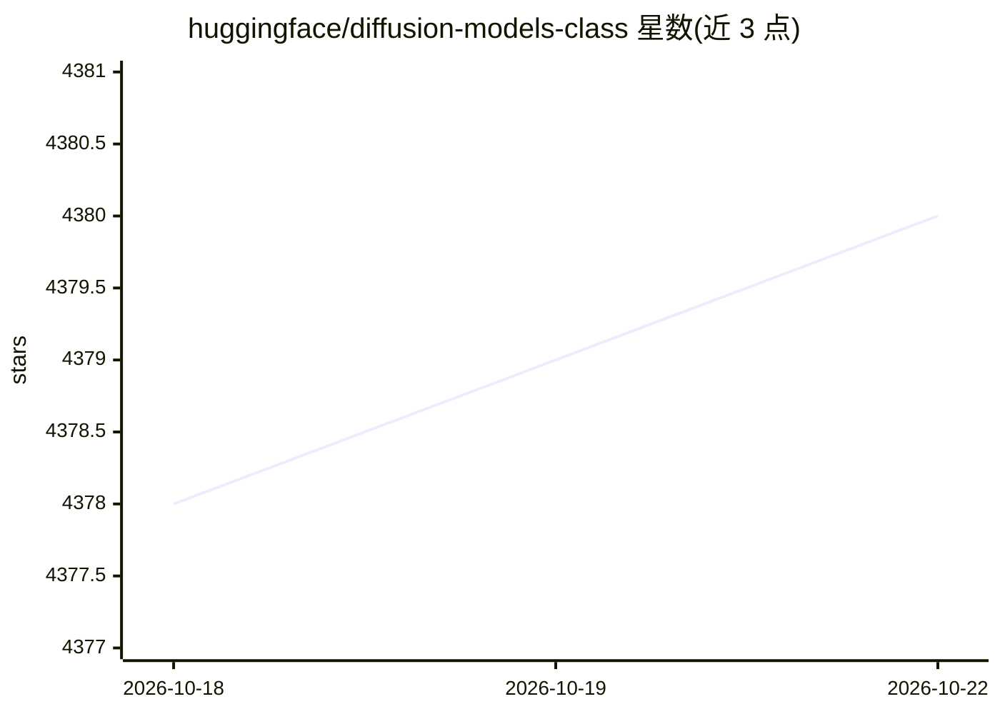

# huggingface/diffusion-models-class

⭐ 4,382 · Jupyter Notebook · Apache-2.0 · 推送 2026-10-14 · [GitHub](https://github.com/huggingface/diffusion-models-class) · 组织维护 · 中文 README

**Hugging Face 免费扩散模型课程的理论与实训教材**

面向具备 Python 与深度学习基础学习者的免费课程仓库：涵盖扩散模型理论、使用 🤗 Diffusers 库生成图像与音频、从零训练扩散模型、微调、条件生成与引导技术，以及自定义 pipeline 构建。课程按单元组织，每单元含理论讲解与一个或多个实操 notebook；提供中文、日文、韩文社区翻译。学习过程中需注册 Hugging Face 账号以推送模型，报名通过表单完成，交流在 Discord 进行。

## 筛选速览

| 维度 | 判定 | 备注 |
|---|---|---|
| AI 角色 | `ai-knowledge` | 知识聚合/清单类 |
| 许可风险 | `permissive` | Apache-2.0 |
| 部署形态 | `None` |  |
| 模型依赖 | — | README 未给出锁定关系 |
| 硬件要求 | — | 无带数字的原话,不猜 |
| 安装摩擦 | `low` | 无编译、无系统依赖或容器化 |
| 成熟度 | — | 结构信号不足 |

## 能力要点

- 涵盖扩散模型理论、训练、微调与条件生成引导
- 每单元配套理论讲解与实操 notebook
- 使用 🤗 Diffusers 库做图像与音频生成
- 提供中文/日文/韩文社区翻译

## 适用场景

- 系统学习扩散模型原理并动手训练自己的模型
- 学习使用 Diffusers 库生成图像与音频
- 微调现有扩散模型到自己的数据集

## 场景标签

`教程课程` · 领域:学习与行业

## 证据(README 行号)

> L8: In this free course, you will:
> L10: - 🧨 Learn how to generate images and audio with the popular 🤗 Diffusers library

## 星数曲线

2026-10-18 4,378 → 2026-10-22 4,380（+2）

---
*卡片 v1 · prompt 1.4 · 生成 2026-10-20 · 置信度 high · 依据 README sha `fcb87cdab6a8` · [字段定义](../../DATASET.md)*
