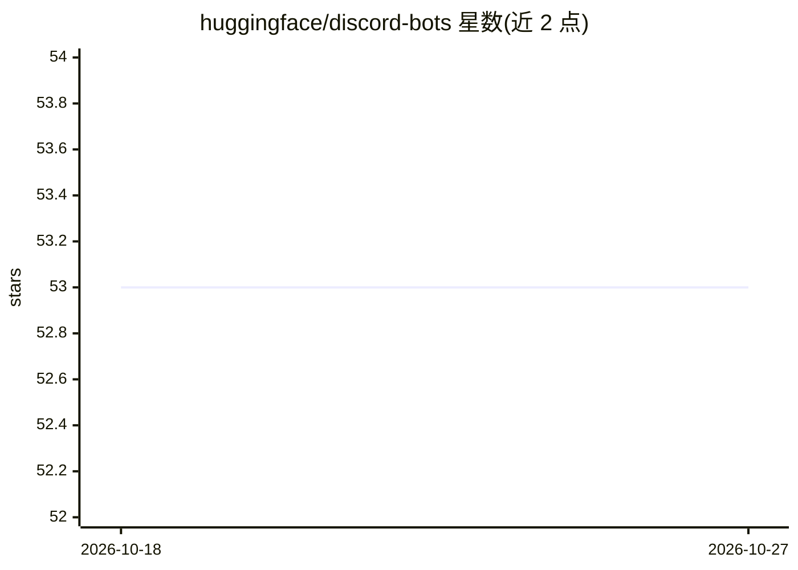

# huggingface/discord-bots

⭐ 53 · Python · 推送 2026-09-23 · [GitHub](https://github.com/huggingface/discord-bots) · 组织维护

**Hugging Face 官方 Discord 机器人代码集，用 Gradio Space 做 ML 后端**

Hugging Face 维护的 Discord 机器人代码合集，涵盖 CodeLlama 13B、DeepFloydIF、Falcon 180B、Wuerstchen、AudioLDM 2、MusicGen 等模型对应 bot 的代码与邀请链接。运行方式：bot 部署在免费档 Space 内作为服务器，通过 gradio_client 将 Hub 上的 Gradio 应用当作 API 调用，把用户 prompt（如生成钢琴音乐）发给对应 Space，取回结果发到 Discord。README 给出构建步骤与简化 Python 示例，未提供本仓库的安装命令。

## 筛选速览

| 维度 | 判定 | 备注 |
|---|---|---|
| AI 角色 | `ai-native` | 本体是模型或模型工具 |
| 许可风险 | `none` | — |
| 部署形态 | `None` |  |
| 模型依赖 | — | README 未给出锁定关系 |
| 硬件要求 | — | 无带数字的原话,不猜 |
| 安装摩擦 | `low` | 无编译、无系统依赖或容器化 |
| 成熟度 | — | 结构信号不足 |

## 能力要点

- 收录 6 个模型 Discord bot 的代码与邀请链接
- 通过 gradio_client 将任意 Gradio Space 用作 bot 的推理 API
- bot 运行在免费档 Hugging Face Space 上

## 适用场景

- 搭建调用 Hugging Face Space 的 ML Discord bot
- 参考 Gradio 应用作为 API 的集成方式
- 为社区提供图像/音乐生成等模型的 Discord 入口

## 场景标签

`聊天机器人` `图像生成` · 领域:对话与助手

## 证据(README 行号)

> L4: |CodeLlama 13B|Code|Invite Bot|
> L39: 2. Query a specific Gradio Space as an API, and send it our prompt

## 星数曲线

2026-10-18 53 → 2026-10-27 53（+0）

---
*卡片 v1 · prompt 1.4 · 生成 2026-10-24 · 置信度 high · 依据 README sha `631eb6c7f71b` · [字段定义](../../DATASET.md)*
