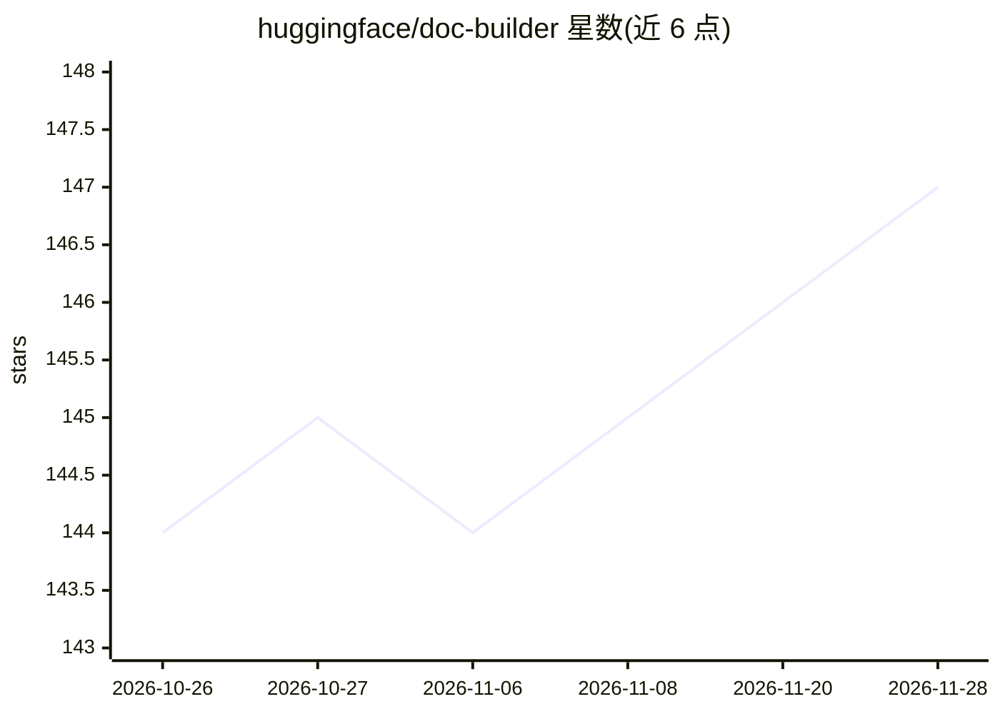

# huggingface/doc-builder

⭐ 147 · Python · Apache-2.0 · 推送 2026-11-24 · [GitHub](https://github.com/huggingface/doc-builder) · 组织维护

**为 Hugging Face 各仓库构建文档站点的 Python 包**

doc-builder 是 Hugging Face 用于构建其仓库文档的工具：读取 Markdown/MDX 源文件，通过 preview 命令本地预览、build 命令生成 MDX 或 HTML（需 Node 14+），支持版本指定、页面级 HTML 缓存、notebook 转 MDX、runnable 代码块标注与 pytest 执行、docstring 样式化及 pre-commit 钩子。提供轻量安装路径，通过 mock 依赖避免为构建文档安装 torch 等重型依赖；--html 构建时同时输出 Markdown 版页面与 llms.txt 供 agent 读取。

## 筛选速览

| 维度 | 判定 | 备注 |
|---|---|---|
| AI 角色 | `ai-enhanced` | 去掉 AI 部分产品仍成立 |
| 许可风险 | `permissive` | Apache-2.0 |
| 部署形态 | `library` | 以包/库形式分发 |
| 模型依赖 | — | README 未给出锁定关系 |
| 硬件要求 | — | 无带数字的原话,不猜 |
| 安装摩擦 | `low` | 无编译、无系统依赖或容器化 |
| 成熟度 | — | 结构信号不足 |

## 能力要点

- preview/build 命令支持 MDX 与 HTML 输出，页面级缓存跳过未变更页面
- mock 重型依赖（torch/deepspeed 等）实现文档构建的轻量安装
- --html 构建同时生成每页 Markdown 与 llms.txt/llms-full.txt 供 agent 读取
- doc-builder style 与 pre-commit 钩子做文档样式检查

## 适用场景

- 为 Python 库或非 Python 项目构建版本化文档站点
- 在 CI 中只安装轻量依赖即可构建 transformers 等库的文档
- 将 jupyter notebook 教程转换为 MDX 文档
- 为 agent 提供 llms.txt 格式的文档订阅源

## 场景标签

 · 领域:开发者工具/文档

## 证据(README 行号)

> L3: This is the package we use to build the documentation of our Hugging Face repos.
> L177: With `--html`, every page also gets a Markdown version (`<page>.md`), served by huggingface.co for "Copy page", fo
> L43: doc-builder build {package_name} {path_to_docs} --build_dir {build_dir}

## 星数曲线

2026-10-26 144 → 2026-11-28 147（+3）

---
*卡片 v1 · prompt 1.4 · 生成 2026-11-27 · 置信度 high · 依据 README sha `96b13d579284` · [字段定义](../../DATASET.md)*
