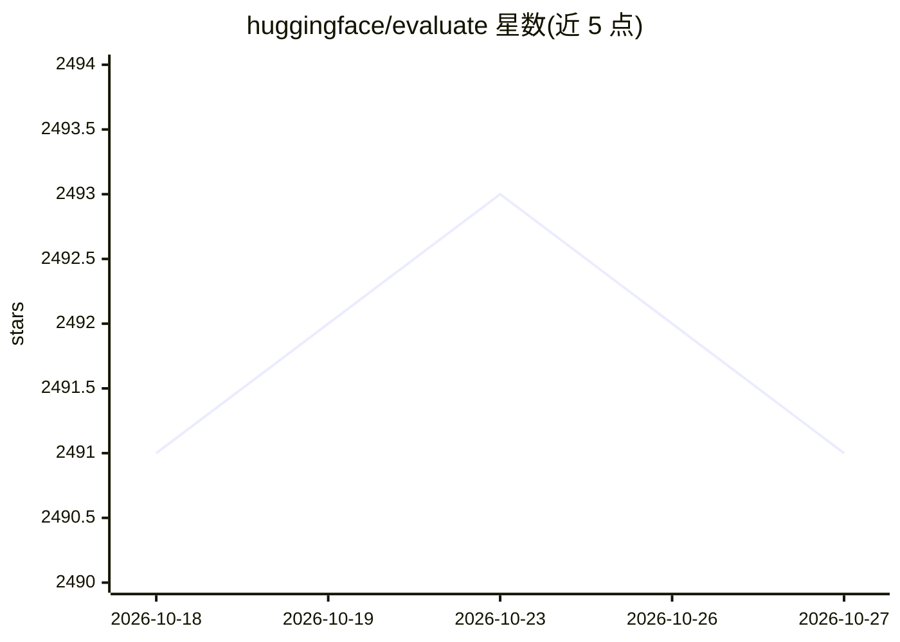

# huggingface/evaluate

⭐ 2,491 · Python · Apache-2.0 · 推送 2026-10-06 · [GitHub](https://github.com/huggingface/evaluate) · [官网](https://huggingface.co/docs/evaluate) · 组织维护

**机器学习模型与数据集的评测指标库**

Hugging Face 维护的评测库：提供数十种现成指标实现（覆盖 NLP 到计算机视觉及数据集专属指标）、模型比较与数据集测量工具，通过 load("accuracy") 一类命令即可加载，兼容 Numpy/Pandas/PyTorch/TensorFlow/JAX 各框架。支持类型检查、指标卡片与社区指标（托管于 Hub），并提供 evaluate-cli 创建并发布新评测模块。README 提示 LLM 等较新评测需求推荐其维护中的新库 LightEval。

## 筛选速览

| 维度 | 判定 | 备注 |
|---|---|---|
| AI 角色 | `ai-ecosystem` | LLM/agent 周边工具 |
| 许可风险 | `permissive` | Apache-2.0 |
| 部署形态 | `library` | 以包/库形式分发 |
| 模型依赖 | — | README 未给出锁定关系 |
| 硬件要求 | — | 无带数字的原话,不猜 |
| 安装摩擦 | `low` | 无编译、无系统依赖或容器化 |
| 成熟度 | — | 结构信号不足 |

## 能力要点

- 数十种指标实现，一行 load() 即可用于任何主流框架
- 模型比较与数据集测量工具
- evaluate-cli create 创建新评测模块并推送到 Hub Space
- 指标卡片描述取值范围与局限

## 适用场景

- 训练后用标准指标评测模型性能
- 比较多个模型在同一数据集上的表现
- 为项目自定义并分享评测指标

## 场景标签

`模型评测` · 领域:评测与运维

## 证据(README 行号)

> L19: 🤗 Evaluate is a library that makes evaluating and comparing models and reporting their performance easier and more 
> L23: - **implementations of dozens of popular metrics**: the existing metrics cover a variety of tasks spanning from NLP

## 星数曲线

2026-10-18 2,491 → 2026-10-27 2,491（+0）

---
*卡片 v1 · prompt 1.4 · 生成 2026-10-21 · 置信度 high · 依据 README sha `58057e2f836f` · [字段定义](../../DATASET.md)*
