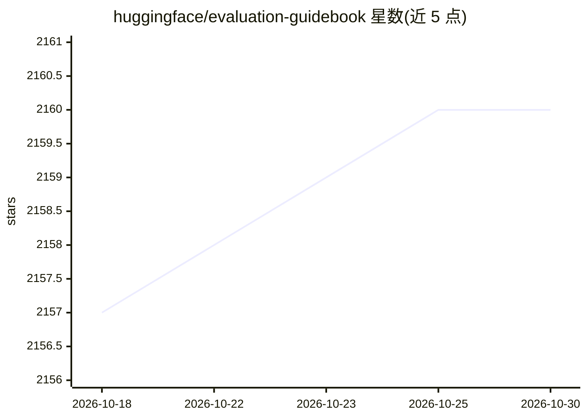

# huggingface/evaluation-guidebook

⭐ 2,160 · Jupyter Notebook · NOASSERTION · 推送 2025-12-03 · [GitHub](https://github.com/huggingface/evaluation-guidebook) · 组织维护 · 中文 README

**LLM 评测方法指南书：面向各层次用户的评测教程**

由 Hugging Face 维护（源自 Open LLM Leaderboard 与 lighteval 的实践经验）的 LLM 评测知识指南：内容按自动基准、人工评测、LLM-as-a-judge、故障排查、LLM 基础知识等章节组织，并含年度主题回顾。面向初学者到高级用户（研究者/工程师/爱好者），提供评测设计方法与实用技巧，非可安装的软件。注意：README 声明本仓库已停止维护，最新版本迁移至 Hugging Face Space。提供社区中文与法语翻译版本，采用 CC BY-NC-SA 4.0 许可。

## 筛选速览

| 维度 | 判定 | 备注 |
|---|---|---|
| AI 角色 | `ai-knowledge` | 知识聚合/清单类 |
| 许可风险 | `none` | NOASSERTION |
| 部署形态 | `None` |  |
| 模型依赖 | — | README 未给出锁定关系 |
| 硬件要求 | — | 无带数字的原话,不猜 |
| 安装摩擦 | `low` | 无编译、无系统依赖或容器化 |
| 成熟度 | — | 结构信号不足 |

## 能力要点

- 覆盖自动基准、人工评测、LLM-as-a-judge、故障排查等章节
- 源自 Open LLM Leaderboard 与 lighteval 的实践经验
- 提供社区中文与法语翻译
- 含年度主题回顾（2023-2025）

## 适用场景

- 入门学习 LLM 评测方法与指标
- 设计自动评测或 LLM-as-a-judge 流程时参考
- 排查推理与可复现性问题前查阅技巧章节

## 场景标签

`模型评测` `教程课程` · 领域:评测与运维

## 证据(README 行号)

> L5: If you've ever wondered how to make sure an LLM performs well on your specific task, this guide is for you!
> L6: It covers the different ways you can evaluate a model, guides on designing your own evaluations, and tips and tricks
> L23: ### Automatic benchmarks

## 星数曲线

2026-10-18 2,157 → 2026-10-30 2,160（+3）

---
*卡片 v1 · prompt 1.4 · 生成 2026-10-21 · 置信度 high · 依据 README sha `f503c09d21f4` · [字段定义](../../DATASET.md)*
