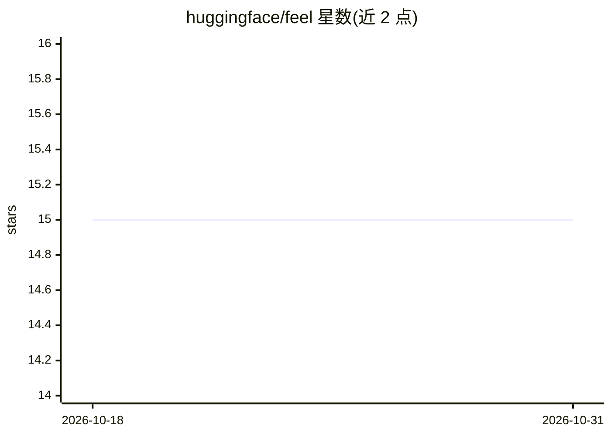

# huggingface/feel

⭐ 15 · Python · Apache-2.0 · 推送 2026-09-23 · [GitHub](https://github.com/huggingface/feel) · [官网](https://huggingface.co/spaces/feel-fl/open-human-feedback-chat) · 组织维护

**社区实时人类反馈驱动的开源 LLM 持续微调平台**

MIT 与 HuggingFace 合作、联合 IBM/Cohere/KAIST 等方开发的自动 RLHF 平台：社区用户在与多语言 LLM 的对话中提供反馈，反馈自动接入 RLHF 流水线，对模型进行实时持续微调，以改进现有开源大模型的多语言能力。仓库包含机器学习代码（数据集与模型目录）与 Gradio 应用两部分，使用 uv 管理虚拟环境并按 ml/app 依赖组安装，可同步部署到 Hugging Face Space（open-human-feedback-chat）。

## 筛选速览

| 维度 | 判定 | 备注 |
|---|---|---|
| AI 角色 | `ai-ecosystem` | LLM/agent 周边工具 |
| 许可风险 | `permissive` | Apache-2.0 |
| 部署形态 | `None` |  |
| 模型依赖 | — | README 未给出锁定关系 |
| 硬件要求 | — | 无带数字的原话,不猜 |
| 安装摩擦 | `low` | 无编译、无系统依赖或容器化 |
| 成熟度 | — | 结构信号不足 |

## 能力要点

- 社区实时反馈即时接入 RLHF 流水线持续微调模型
- 聚焦改进开源 LLM 的多语言能力
- ml/ 与 app/（Gradio）双模块结构，uv 管理环境
- 支持推送同步到 Hugging Face Space 部署

## 适用场景

- 作为社区成员通过对话反馈参与开源模型改进
- 搭建自动 RLHF 人类反馈采集与持续微调流水线
- 跟进多语言 LLM 的社区共建训练方案

## 场景标签

`微调` `强化学习` · 领域:训练与推理

## 证据(README 行号)

> L14: This repository hosts the development of a novel automated RLHF platform where the community can provide feedback w
> L22: FeeL = Feedback Loop. It is a platform that enables the community to provide real-time feedback on language models.

## 星数曲线

2026-10-18 15 → 2026-10-31 15（+0）

---
*卡片 v1 · prompt 1.4 · 生成 2026-10-30 · 置信度 high · 依据 README sha `73faf517ec17` · [字段定义](../../DATASET.md)*
