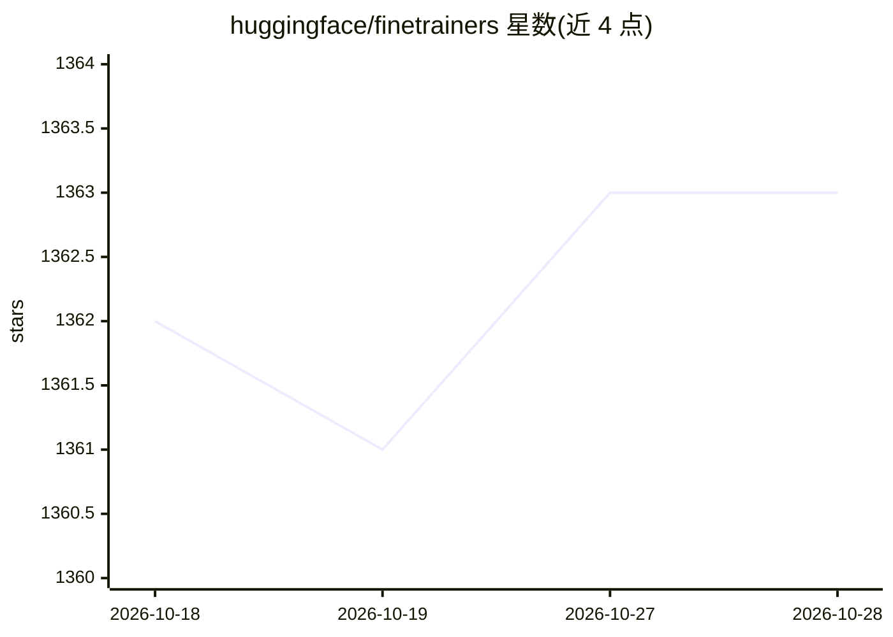

# huggingface/finetrainers

⭐ 1,363 · Python · Apache-2.0 · 推送 2026-09-23 · [GitHub](https://github.com/huggingface/finetrainers) · 组织维护

**扩散模型微调训练库：LoRA/全参训练视频与图像生成模型**

Hugging Face 维护的扩散模型训练库，支持 LTX-Video、HunyuanVideo、CogVideoX、Wan、CogView4、Flux 等模型的 SFT 与 Control 训练，提供 LoRA 与全参微调。机制上支持 DDP/FSDP-2/HSDP/CP 分布式训练、多注意力后端（flash/flex/sage/xformers）、数据集自动识别与多分辨率分桶、条件预计算和 FP8 量化训练以降低显存占用。项目自述为进行中（work-in-progress），main 分支为开发分支，稳定功能以 release tag 为准；README 列出各模型最低 VRAM 需求。安装为 git clone 后 pip 安装依赖并从源码安装 diffusers。

## 筛选速览

| 维度 | 判定 | 备注 |
|---|---|---|
| AI 角色 | `ai-ecosystem` | LLM/agent 周边工具 |
| 许可风险 | `permissive` | Apache-2.0 |
| 部署形态 | `library` | 以包/库形式分发 |
| 模型依赖 | — | README 未给出锁定关系 |
| 硬件要求 | — | 无带数字的原话,不猜 |
| 安装摩擦 | `low` | 无编译、无系统依赖或容器化 |
| 成熟度 | `idea` | |

## 能力要点

- 支持 LTX-Video/HunyuanVideo/CogVideoX/Wan/CogView4/Flux 等模型训练
- LoRA 与全参微调、Conditional Control 训练
- DDP、FSDP-2、HSDP、CP 分布式训练与多注意力后端
- 显存优化：预计算、梯度检查点、FP8 训练（如 24GB 内训练 HunyuanVideo）

## 适用场景

- 给视频生成模型做 LoRA 微调训练
- 用自定义数据集训练 Control 类条件控制模型
- 在单卡上以低显存方案微调大型视频扩散模型

## 场景标签

`微调` · 领域:训练与推理

## 证据(README 行号)

> L3: Finetrainers is a work-in-progress library to support (accessible) training of diffusion models and various commonly
> L45: - DDP, FSDP-2 & HSDP, CP support
> L83: |**Model Name**|**Tasks**|**Min. LoRA VRAM * **|**Min. Full Finetuning VRAM ^ **|

## 星数曲线

2026-10-18 1,362 → 2026-10-28 1,363（+1）

---
*卡片 v1 · prompt 1.4 · 生成 2026-10-21 · 置信度 high · 依据 README sha `4e8c5f162e3d` · [字段定义](../../DATASET.md)*
